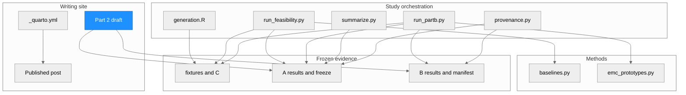
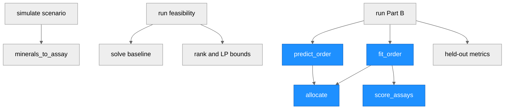
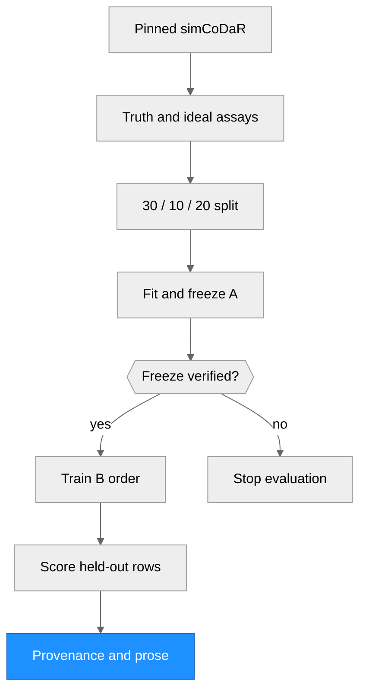

# Architecture — EMC feasibility writing and prototype

> Run `REQ-20261026-emc-part2`, 26 October 2026. This repository is a Quarto writing site; the research code is a bounded, standalone experiment, not a package API.

## System Architecture

### Module Structure

| Module / file | Purpose | Key dependencies | Changed in this run |
| --- | --- | --- | --- |
| `_quarto.yml`, published post | Site render list and Part 1 context | Quarto | No |
| `drafts/emc-part2-review.qmd` | Review article excluded from site render | Frozen A/B evidence | Yes, docs phase |
| `research/emc-part2a/generation.R` | Known-truth ideal assay generation | Pinned simCoDaR | Yes, simulator phase |
| `research/emc-part2a/run_feasibility.py`, `baselines.py` | Freeze fixtures and five baseline fits | NumPy, SciPy | Yes, simulator phase |
| `research/emc-part2a/run_partb.py` | B fit orchestration and held-out scoring | Frozen A, proposed solver | Yes, simulator phase |
| `research/emc-part2a/summarize.py`, `reporting_provenance.py` | Aggregate metrics and provenance derivatives | CSVs, freeze manifest | Yes, simulator phase |
| `research/emc-part2b/prototypes/emc_prototypes.py` | Allocation, scoring, finite order search | NumPy | Yes, builder phase |
| `research/emc-part2a/fixtures`, `results`; `research/emc-part2b/results` | Input, predictions, hashes and findings | Prior stages | Yes, simulator/tester phase |

### Function Call Graph

| Function | Defined in | Called by | Purpose | Changed |
| --- | --- | --- | --- | --- |
| `simulate_mineral_assay_scenario`, `minerals_to_assay` | simCoDaR dependency | `generation.R` | Generate truth and oxide response | No |
| `solve` | `baselines.py` | `run_feasibility.py` | Five rowwise baseline fits | Yes |
| `fit_order` | `emc_prototypes.py` | `run_partb.py` | Train global phase order from assays | Yes |
| `allocate`, `predict_order` | `emc_prototypes.py` | `fit_order`, `run_partb.py` | Limiting component fit and replay | Yes |
| `score_assays` | `emc_prototypes.py` | `fit_order`, `run_partb.py` | Row and distribution losses | Yes |

### Data Flow

| Stage | Input | Output | Changed |
| --- | --- | --- | --- |
| Fixture generation | Pinned R source and seeds | Truth, assay rows, response matrices | Yes |
| A freeze | Fixtures and five solvers | Frozen baseline results and hash ledger | Yes |
| B evaluation | Verified A freeze and training assays | Orders, predictions, metrics, traces | Yes |
| Documentation | Audited CSVs and source ledger | Research reports and excluded Quarto draft | Yes |

## Notes

Part B fitting sees assays and chemistry, not mineral truth; truth enters held-out evaluation. The draft remains outside the site's render list. The historical v2 snapshot has one unavailable referenced manifest (55/56); the current freeze verifies 55/55.
