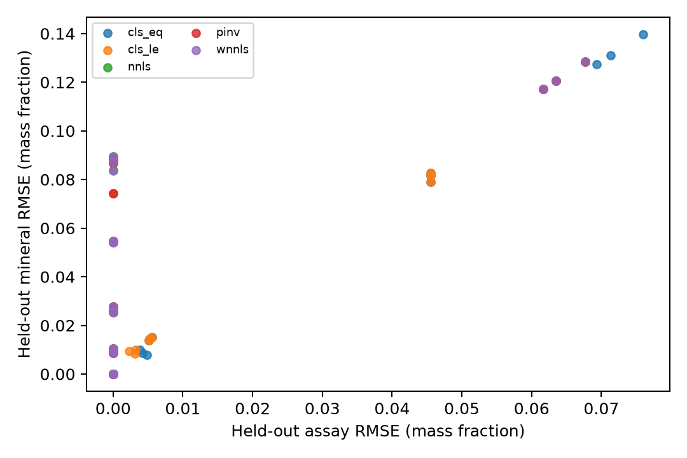

## The question before the algorithm

Element-to-mineral conversion (EMC) uses chemical assays and an assumed mineral response matrix to estimate mineral abundances. It is tempting to judge an estimate by how closely its reconstructed assays match the observations. That check is necessary for the assumed mass balance, but it cannot always distinguish minerals. Two minerals with the same measured chemistry can trade mass without changing a single assay. More elaborate order search or distribution matching cannot recover information absent from the measurements.

This Part 2 study asks a narrower empirical question: after freezing simple chemical baselines, can a limiting-component allocator with a chosen mineral order, or an assay-distribution objective, materially improve held-out mineral estimates? It uses small, known-truth synthetic cases generated through the public [simCoDaR](https://github.com/ClausonGeomet/simCoDaR) interface. It is a feasibility check, not field validation, an HSC implementation or a new EMC package. The [Part A record](../research/emc-part2a/README.md) and [Part B record](../research/emc-part2b/RESEARCH_FINDINGS.md) contain methods, source limits and full result paths.

## Chemistry, closure and identification

For specimen $s$, write

$$
\mathbf a_s=C\mathbf m_s+\boldsymbol\epsilon_s,
$$

where $\mathbf a_s$ is an unnormalized vector of whole-sample assay mass fractions, $\mathbf m_s$ is whole-sample mineral mass fraction and $C$ is the fixed response matrix on the same analyte basis. Nonnegative least squares (NNLS) restricts $\mathbf m_s\geq0$ but does not make its entries sum to one. Equality closure $\mathbf1^\top\mathbf m_s=1$ requires a complete mineral list. With an incomplete list, $\mathbf1^\top\mathbf m_s\leq1$ leaves $u=1-\mathbf1^\top\mathbf m_s$ unallocated. That residual mass is bookkeeping; it does not name a missing phase. Similarly, an assay residual can reflect noise, an omitted phase, incorrect chemistry or incompatible reporting bases.

We froze unrestricted pseudoinverse, NNLS, assay-weighted NNLS, equality constrained least squares (`cls_eq`) and partial-closure constrained least squares (`cls_le`) before evaluating the new heuristic. Singular-value and exact feasible-range diagnostics accompany the fits. The [frozen contract amendment](../research/emc-part2a/CONTRACT_DEVIATIONS.md) discloses that Part A returns residual `reconstructed-a`, whereas Part B returns `a-reconstructed`. The old tester oracle matched the legacy Part A sign but was wrong against the original contract; its historical PASS is not an original-contract PASS. Focused checking passed the amended convention only. Part A `objective` always reports a squared sigma-weighted diagnostic at the returned estimate, without a one-half factor; for ordinary `pinv` and `nnls`, it is not their minimized unweighted fitting objective. These choices follow the identifiability issues explained by [Whiten (2008)](https://doi.org/10.1080/08827500701257860). Operational [HSC Geo documentation](https://www.metso.com/globalassets/portfolio/hsc-chemistry/84-geo---mineralogical-calculations-and-mineral-database.pdf) describes staged rules, residual accounting and NNLS; the generic allocator below is not a reproduction of its rules. Deposit-specific [Lund et al. (2013)](https://ltu.diva-portal.org/smash/record.jsf?pid=diva2%3A986559) provides a validation precedent, although only the institutional abstract was inspected here. The [literature ledgers](../research/emc-part2a/LITERATURE_REVIEW.md) and [Part B review](../research/emc-part2b/LITERATURE_REVIEW.md) state access levels for older and 2026 work.

The exact counterexample uses Quartz, Anatase and Rutile, with the latter two sharing the measured TiO2 response. In 180 paired synthetic rows, swapping their true fractions changes phase-specific mineralogy while leaving each SiO2/TiO2 assay row **exactly** unchanged. The response has rank two for three phases, and adding closure leaves rank two. Feasible Anatase intervals have widths 0.213–0.617 across those specimens. Perfectly matching the full assay distribution, therefore, does not identify the mineral split. It is stronger evidence than a disagreement between assay and mineral error averages.

{fig-alt="Synthetic Anatase and Rutile phase allocations can differ while measured SiO2 and TiO2 remain identical."}

## A bounded comparison

Six cases probe different failure modes: easy full-rank exact chemistry, ambiguous chemistry, signed Gaussian assay noise, an omitted Forsterite phase, wrong fitted Kaolinite chemistry and assays scaled beyond exact closed feasibility. Each has three replicates of 60 specimens, split by recorded sample IDs into 30 training, 10 validation and 20 test rows. The pinned generator is simCoDaR commit `d9a0b27676a0cb3a4acb300a3f6b2ebc845d205d`; R seeds are `20261026+100r` for base cases and `20261027+100r` for ambiguous cases, with Python noise derived from PCG64 `SeedSequence([20261026,scenario_index,r,0])`. Oxide wt% was divided by 100 once, without closing the assays, and the total-iron channel is `Fe2O3_total`. The source and split manifests preserve all settings. Synthetic XRD output is ideal generated data, not measured mineral ground truth.

The proposed allocator visits minerals in an order. For each phase, it takes the smallest amount allowed by the remaining mass and every required assay component, then subtracts its chemical response. This conserves mass and measured components on supported nonnegative inputs, but an early phase can consume a shared element needed later. A ratio with a small response coefficient is sensitive to assay noise; negative noisy channels are explicitly unsupported rather than silently clipped. The same allocator is used for fixed, exhaustive, greedy, beam, random and genetic-algorithm (GA) order search. There are at most 24 orders. A global order is fit to training assays only, then applied unchanged to held-out specimens; mineral truth does not enter fitting. Exhaustive search is an oracle for this finite training objective only. GA has no global-optimum guarantee.

The row objective is mean squared standardized assay error. The distribution objective adds standardized differences in analyte means and covariances plus Jensen–Shannon divergence of each analyte's empirical histogram. These components are reported separately. The extra weights were fixed as a sensitivity choice, not estimated uncertainty. Marginal histograms do not determine the full multivariate assay law; even the full law would not break the Anatase/Rutile equivalence. [Lin (1991)](https://ieeexplore.ieee.org/abstract/document/61115/authors) motivates the JS divergence, while [Egozcue et al. (2003)](https://doi.org/10.1023/A:1023818214614) motivates positive-support logratio diagnostics. ILR distances are reported only when both mineral vectors are strictly positive and comparable; zeros are not repaired with arbitrary pseudocounts.

## Held-out results

The predeclared Part A comparator is `cls_eq` except `missing_phase`, which uses `cls_le`. Table values average three 20-specimen test splits, in whole-sample mass fractions, and are rounded to six decimals. B uses exhaustive order search for a fixed allocator under either objective. The complete per-replicate results and provenance are in [Part B results](../research/emc-part2b/RESEARCH_FINDINGS.md).

| Case | A assay RMSE | A mineral RMSE | B row assay | B row mineral | B distribution assay | B distribution mineral |
| --- | ---: | ---: | ---: | ---: | ---: | ---: |
| Easy | 0.000000 | 0.000000 | 0.000000 | 0.000000 | 0.000000 | 0.000000 |
| Ambiguous | 0.000000 | 0.083206 | 0.000000 | 0.086836 | 0.000000 | 0.086836 |
| Noisy | 0.004316 | 0.008752 | 0.004978 | 0.009772 | 0.004978 | 0.009772 |
| Missing phase | 0.064301 | 0.122035 | 0.064301 | 0.122035 | 0.064301 | 0.122035 |
| Wrong chemistry | 0.005288 | 0.014450 | 0.012803 | 0.033874 | 0.012803 | 0.032428 |
| Infeasible | 0.045520 | 0.081103 | 0.063043 | 0.116787 | 0.097596 | 0.080003 |

{fig-alt="Held-out assay and mineral errors vary by synthetic scenario; the ambiguous case has near-zero assay error but appreciable mineral error."}

We declared a feasibility benefit only if mineral RMSE fell by at least 0.01 versus the predeclared A comparator in at least two of three matched replicates, without increasing mean assay RMSE by more than 0.001. The [all-seed analysis](../research/emc-part2b/ALL_SEED_ANALYSIS.md) retains [1,296 complete comparisons](../research/emc-part2b/results/all_seed_comparisons.csv), [648 seed-median groups](../research/emc-part2b/results/all_seed_medians.csv), and [120 benefit groups](../research/emc-part2b/results/all_seed_benefit.csv). **All 120 B method/objective/seed groups fail** the prospective benefit rule; no B/A pair reaches the 0.01 mineral threshold. No best seed was selected.

Search markedly improves the weak fixed allocation order in easy and missing-phase cases, among others. That gain is within B. Against constrained A, optimized B still does not meet the declared benefit criterion. Distribution scoring at the same search method and seed usually leaves held-out errors unchanged. In infeasible assays, it can lower mineral RMSE by about 0.03–0.054 per replicate while raising assay RMSE by about 0.034, above the 0.001 allowance.

Across seeds 101–103, GA has joint training-score-within-`1e-10`, fewer-evaluations and lower-fit-time wins versus beam in **18/54 row** and **14/54 distribution** matched pairs. The earlier seed-101-only result of 0/36 joint wins was a subset. GA has **0/54** wins versus greedy for each objective and **45/54 row**, **42/54 distribution** versus exhaustive. The [three-replicate GA verdicts](../research/emc-part2b/results/all_seed_ga_efficiency.csv) pass the ≥2/3 rule versus beam in only 6/18 row and 5/18 distribution scenario/seed groups. Seed-dependent millisecond times do not establish a general speed guarantee. All 360 planned fits completed, with no unexpected failures in the generated samples. The focused replay passed the approved Part A legacy convention; the original residual contract failed. Earlier Part A numerical failures remain retained: v1 had 13 solver failures, v2's historical snapshot lacks one referenced manifest (55/56), and current v3 verifies 55/55 after stricter stopping.

## What would change the inference?

Independent phase-sensitive observations can constrain a chemical null direction; another Ti-total measurement cannot split Anatase from Rutile. Calibrated mineral chemistry, defensible uncertainty models and deposit-specific geological constraints may also help, but none can be inferred from this generic pilot. A plant circuit reconciliation would be a separate problem involving uncertain flows and stream conservation; weighted rowwise EMC here does not fit such a circuit. [Metso's overview](https://www.metso.com/insights/blog/mining-and-metals/mass-balancing-of-concentrator-data/) is a primary description of that different setting.

Several paired-data candidates were screened, including [CSIRO Fortescue](https://data.csiro.au/collection/csiro:6753), Mary-Wildman and [Cannington](https://repository.data.auscope.org.au/dataset/cloncurry-metal-multimodal-integrated-mineral-system-characterisation-data). None passed the current source, basis, phase-completeness, censoring and independent-holdout checks. The earlier Fortescue 14/5/4 split was already exposed and its prior failure is not a new result. Fresh external validation remains pending. The present evidence supports caution about identifiability and gives a reproducible, limited comparison of algorithms; it does not establish field accuracy or geological generality.
