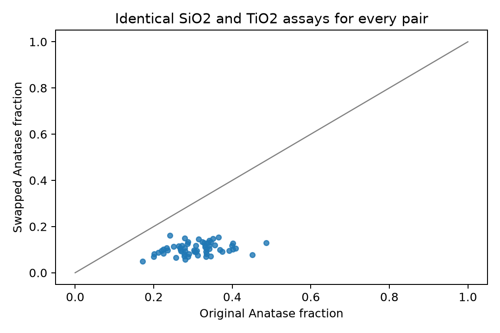
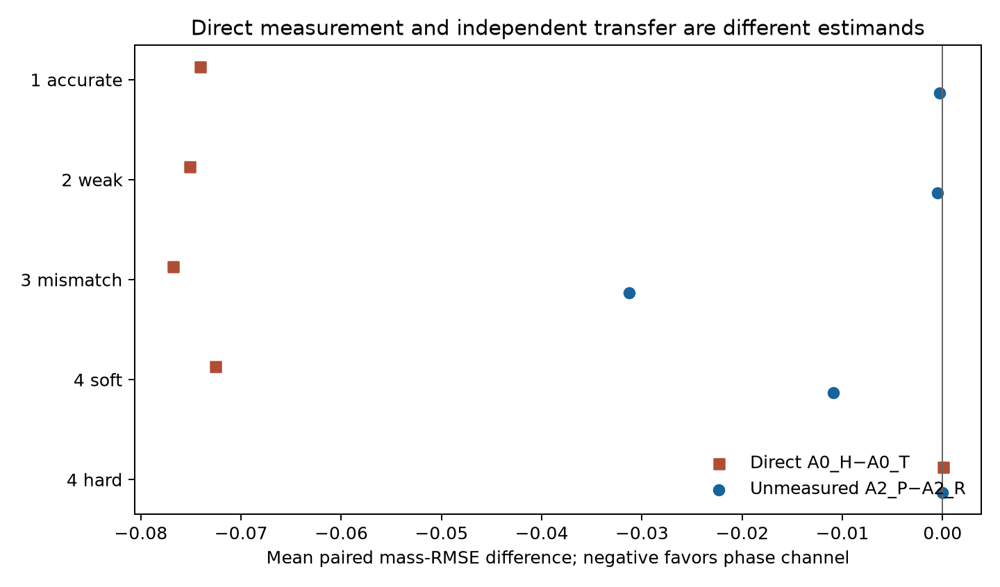

<nav class="article-mobile-outline" aria-label="Article outline">

On this page

<ol>
<li><a href="#a-good-assay-fit-can-conceal-the-wrong-minerals" class="no-external" target="_self">A good assay fit can conceal the wrong minerals</a></li>
<li><a href="#baselines-and-the-cost-of-assumptions" class="no-external" target="_self">Baselines and the cost of assumptions</a></li>
<li><a href="#what-order-search-did-and-what-it-could-never-supply" class="no-external" target="_self">What order search did, and what it could never supply</a></li>
<li><a href="#independent-calibration-helpful-information-fallible-information" class="no-external" target="_self">Independent calibration: helpful information, fallible information</a></li>
<li><a href="#measuring-a-phase-is-different-from-transferring-its-lesson" class="no-external" target="_self">Measuring a phase is different from transferring its lesson</a></li>
<li><a href="#what-must-be-measured-next" class="no-external" target="_self">What must be measured next</a></li>
<li><a href="#evidence-and-review-status" class="no-external" target="_self">Evidence and review status</a></li>
</ol>

</nav>

## A good assay fit can conceal the wrong minerals

Element-to-mineral conversion (EMC) estimates mineral amounts from a bulk chemical assay and assumed mineral compositions. The assay tells us how much of each measured chemical component is present. It does not necessarily tell us which mineral carries that component. A reconstruction can match every measured component while assigning the wrong phases. That distinction matters when a decision depends on mineralogy rather than bulk chemistry.

For a specimen, let $\mathbf a$ be the vector of measured analyte mass fractions, $\mathbf m$ the nonnegative mineral mass fractions, and $C$ the assumed chemical response of each mineral. On a common whole-sample mass basis, the working model is

$$
\mathbf a=C\mathbf m+\boldsymbol\epsilon.
$$

The residual $\boldsymbol\epsilon$ may include analytical error, but a large residual can also signal an omitted mineral, incorrect mineral chemistry or incompatible reporting bases. Conversely, a small residual is no certificate of correct mineralogy. Assays here are signed, unclosed measurements; forcing their components to sum to one would change the measurement model.

Consider the deliberately simple Quartz–Anatase–Rutile (QAR) example. Quartz supplies the measured SiO2 response, while Anatase and Rutile have the same measured TiO2 response. Moving mass from Rutile to Anatase leaves both assay channels and total mineral mass unchanged. The [Part A counterexample — repository source](https://github.com/ClausonGeomet/writing/blob/d2f69fe3b4375a4a3dd03ea1ac2cb40149ee8b79/research/emc-part2a/RESEARCH_FINDINGS.md) constructs such paired synthetic compositions with exactly identical assays. Its picture shows a structural ambiguity, not a claim that every ore has this ambiguity or that boundaries can never resolve a particular specimen. Even matching the entire assay distribution cannot distinguish two compositions that give the same assay for every specimen.

{fig-alt="Pairs of synthetic mineral compositions exchange Anatase and Rutile while their bulk assays stay identical."}

The practical question is therefore twofold: how well does an estimator honor the measured chemistry, and how much phase information do those measurements actually contain? The first is a fitting question. The second needs either a justified prior about phase occurrence or a new measurement sensitive to the missing phase contrast. Neither should be smuggled in as if it came from the bulk assay.

## Baselines and the cost of assumptions

Ordinary nonnegative least squares (NNLS) chooses mineral amounts that minimize squared assay residuals subject to nonnegative amounts. Weighted least squares gives different assay channels different precision weights. Those weights should describe **measurement error under a stated protocol**, including relevant covariance, rather than correlations between rock types in a dataset. These are useful chemical-fit baselines, although neither fit by itself resolves minerals with identical measured responses. [Part A's mathematical design — repository source](https://github.com/ClausonGeomet/writing/blob/d2f69fe3b4375a4a3dd03ea1ac2cb40149ee8b79/research/emc-part2a/MATHEMATICAL_DESIGN.md) records the precise baseline definitions.

Constrained least squares (CLS) also restricts the sum of mineral fractions. Equality closure, a sum of one, is justified only when the mineral inventory is complete on the stated basis. Partial closure, a sum at most one, leaves the difference as unallocated whole-sample mass. That difference is bookkeeping: it does not identify an omitted mineral or quantify amorphous content by itself. Likewise, a nonzero chemical residual cannot be assigned automatically to an omitted phase. Part A compared unrestricted, NNLS, weighted NNLS and both closure variants under frozen synthetic cases, including missing phases, assay noise and wrong assumed chemistry. These are specimen-level fits, not plant-stream mass reconciliation with uncertain flows.

The accepted [contract deviations — repository source](https://github.com/ClausonGeomet/writing/blob/d2f69fe3b4375a4a3dd03ea1ac2cb40149ee8b79/research/emc-part2a/CONTRACT_DEVIATIONS.md) also matter to anyone reusing the numerical record: legacy Part A and Part B report opposite residual signs, and Part A's reported weighted objective is a diagnostic at the returned estimate for some unweighted baselines. Its historical legacy check is not a pass against the original residual contract. The article uses error magnitudes and original report definitions, without silently repairing those frozen outputs.

A low observed-assay error can be especially misleading in the QAR example. The fitting procedure may distribute Ti-bearing mass between Anatase and Rutile almost arbitrarily while matching total Ti. If the assay is noisy, fitting it more closely need not improve recovery of the noiseless chemistry either. The accepted reports distinguish error against the **observed noisy assay** from error against the **latent noiseless assay**. Their mineral errors concern known synthetic truth; no comparable truth was established for field samples here.

## What order search did, and what it could never supply

Part B tested a sequential allocator that visits candidate minerals in an order. At each step, the fixed greedy rule allocates as much of that mineral as the remaining mass and nonnegative assay components permit. Early choices can consume an element needed by a later mineral. Changing order can therefore change the answer. The order is a computational choice, not a reconstruction of geological formation history. The study compared fixed, exhaustive, greedy, beam, random and genetic-algorithm (GA) order search, with either rowwise assay matching or an additional distribution-matching score. A selected order was learned from training assays, then held fixed on test specimens; mineral truth was not used to fit it.

The exploratory pilot comprised six known-truth synthetic cases, with three replicates of 60 specimens each and 30/10/20 train/validation/test splits. The prospective benefit rule required a mineral RMSE reduction of at least 0.01 whole-sample mass fraction in at least two of three matched replicates, with mean assay RMSE increasing by no more than 0.001. [All 120 method/objective/seed groups failed that rule — repository source](https://github.com/ClausonGeomet/writing/blob/d2f69fe3b4375a4a3dd03ea1ac2cb40149ee8b79/research/emc-part2b/ALL_SEED_ANALYSIS.md). Order search could improve a poor fixed order within the allocator family, yet none met the declared benefit against the constrained Part A comparator. A distribution score could trade better mineral error in a particular infeasible case for an assay error increase beyond the allowance. These are descriptive pilot results, not a significance test or proof that no heuristic can ever help. GA had no global optimum guarantee, and seed-dependent runtime comparisons do not establish one.

A later [exact reachability result — repository source](https://github.com/ClausonGeomet/writing/blob/e460bea3d2e12d621dbe51887cb1bf9c1ab42f4b/research/emc-part2b/prior_guided/MATHEMATICAL_DESIGN.md) clarifies the role of order. If every mineral receives a **freely chosen specimen-specific fraction** of its current residual-resource cap, with fixed nonnegative chemistry and nonnegative resources, every permutation reaches the same final feasible set: nonnegative mineral amounts that use no more than the available assay components or mass budget. In this setting, changing order cannot improve the best achievable value of a common final-state objective. This is a statement about mathematical reachability, not about the fixed greedy rule, finite GA search, common fractions across specimens, signed noisy assays or order-dependent chemistry. Noisy constrained least squares also need not obey these resource inequalities. The proof limits one proposed advantage of order; it does not make the chemical inverse unique.

## Independent calibration: helpful information, fallible information

An independent mineralogical calibration set can tell us which phase splits are common in a defined population. In the finite-calibration QAR study, A0 uses assay loss alone and splits an exact Ti tie by minimum Euclidean norm. A1 uses only a calibrated center, projected onto the allowed mineral fractions; it does **not** use the target assay and is not a posterior predictive mean. A2 combines target assay loss with a finite quadratic penalty toward that learned center. The penalty also uses estimated variation within the calibration population and an approximation to uncertainty in its mean. Its covariance floor and shrinkage are prescribed choices; uncertainty in the covariance estimate itself is not integrated. The calibration and evaluation cohorts are independent synthetic draws, and their known laboratory covariance is part of the design, not an empirical result.

For each cohort, mass RMSE is the square root of mean squared phase-mass error across its evaluation specimens and the three phases; reported values average those cohort RMSEs. Paired SEs use the 50 independent cohort differences, not pooled specimens. Multiplying a whole-sample fraction by 100 gives percentage points.

The [finite-calibration results — repository source](https://github.com/ClausonGeomet/writing/blob/e460bea3d2e12d621dbe51887cb1bf9c1ab42f4b/research/emc-part2b/prior_guided/FINITE_CALIBRATION_RESULTS.md) cover ten cells with 50 independent cohorts per cell and 40 evaluation specimens per cohort. Primary cells use calibration sizes 10, 30 and 100; stress cells use 30. In fixed-Quartz cells, A1 and A2 coincide to numerical precision: the target assay has no information about the Anatase/Rutile split, so it cannot update that part of the center. In variable-Quartz cells, A2 can use the assay to correct observed Quartz and total Ti while still relying on calibration for the split. For example, in the matched variable-Quartz cell with 30 calibration specimens, mean cohort mass RMSE was 0.09227 for A0, 0.08454 for center-only A1 and 0.03246 for A2. These errors are whole-sample mass fractions, averaged over cohort RMSEs; the figure 0.03246 is not an error in percentage *relative* to true abundance.

The advantage depends on calibration resembling the evaluation population. In the deliberately mismatched cell, A2 mass RMSE was 0.17443 versus A0's 0.09208; the paired A2 minus A0 difference was **+0.08235** with descriptive cohort SE 0.00099. A tight but wrong phase preference can therefore harm mineral inference while the bulk assay still fits. One weak-prior and one high-noise calibration stress cell did not reverse the A2 advantage in that frozen grid, but they do not establish a general robustness trend. A wrong occurrence assumption can exclude the true phase altogether. The earlier three-replicate order-search pilot and this 50-cohort calibration study answer different questions and should not be pooled.

## Measuring a phase is different from transferring its lesson

A phase-sensitive observation acts directly on the missing QAR contrast. A repeated Ti-total assay may sharpen total Ti precision, but its response to an Anatase-for-Rutile swap remains zero. An Anatase-sensitive channel responds to the swap. Under the stated closed model, the bulk and redundant-Ti designs constrain one independent composition direction; the phase design constrains two. Rank describes which directions can be seen under the model. It does not establish useful real-world precision, phase accuracy or coverage.

The [phase-sensitive study — repository source](https://github.com/ClausonGeomet/writing/blob/2f172838f8ae3259cbace688551b158447398796/research/emc-part2b/phase_sensitive/RESULTS.md) separates two outcomes. A **direct** specimen receives the phase measurement itself. An **independent unmeasured** evaluation specimen receives only bulk assay; purchasing phase tests on other specimens may improve its learned population prior, but the target's invisible contrast remains unmeasured. Each of four synthetic cells has 50 independent cohorts. Within each cohort, 20 units calibrate, 20 enter the direct comparison, 10 form a purchase pool, and 30 are separate evaluation units. Budgets of zero, two and five pool tests were examined. The two analyses of cell 4, soft and hard occurrence assumptions, reuse the same observations; they are not a fifth independent cell. The simulated phase-reading SD of 0.02 mass fraction and known Gaussian covariance are declared assumptions, not measured laboratory performance.

For direct cell 1, the assay-only A0 mean mass RMSE was 0.090938 with bulk chemistry, 0.090934 after a redundant Ti reading, and 0.016829 with the phase-sensitive reading. These are mean cohort RMSEs for targets that were actually measured. The contrast is large because the new observation sees the previously missing direction on those specimens. It cannot be reported as a benefit for unmeasured specimens.

The distinction is easiest to keep in view by asking which specimen received the extra observation:

| Decision target | New information | Illustrative synthetic result | What it cannot establish |
| --- | --- | --- | --- |
| Directly measured unit | Its own phase-sensitive reading | Cell 1 A0 mass RMSE 0.016829 with phase reading, versus 0.090938 bulk only | Benefit on an unmeasured unit |
| Independent unmeasured unit | Phase readings on other pool units update a population prior | Accurate-prior five-purchase A2 $P-R$ difference −0.000292 (SE 0.000098) | Direct identification of that unit’s phase split |
| Prior-mismatched unmeasured unit | Same transfer route under a wrong starting preference | A2 with phase purchases 0.144813 versus prior-free A0 0.092592 | That additional data erased prior harm |

{fig-alt="Direct target measurement gives a larger mineral-error reduction than population-prior transfer to independent targets with only bulk assays."}

For independent unmeasured targets, the primary comparison at five purchases is A2 with phase purchases ($P$) minus A2 with matched replicate-bulk purchases ($R$). Negative differences favor phase purchases. Selected mean paired differences across 50 cohorts were −0.000292 (descriptive SE 0.000098) for the accurate-prior cell, −0.000477 (0.000158) for the weak-prior cell, and −0.031298 (0.000817) for the mismatched-prior cell. The source [full table — repository source](https://github.com/ClausonGeomet/writing/blob/2f172838f8ae3259cbace688551b158447398796/research/emc-part2b/phase_sensitive/RESULTS.md#primary-independent-unmeasured-transfer-result) also reports both wrong-occurrence analyses and all arm means. These are RMSE differences in whole-sample mass fraction, not percentage improvements, confidence intervals or tests of significance. Purchased units used whole-unit leave-one-out prediction; the independent evaluation units had no phase reading.

The mismatched cell exposes the danger of reporting only the $P$ versus $R$ contrast. Phase purchases improve A2 relative to replicate bulk, but A2 with phase purchases still has mean RMSE **0.144813**, compared with **0.092592** for the prior-free A0 on the same purchased-phase arm. The paired excess is +0.052221 (descriptive SE 0.001208). The extra information partly corrects the wrong prior without erasing its harm. In cell 4, a soft wrong-occurrence preference can be challenged by phase evidence: the unmeasured $P-R$ difference was −0.010900 (0.000387). A hard assumption that Anatase is absent removes it from the feasible set; the corresponding difference was only −0.000020 (0.000001), not recovery of a forbidden mineral. Soft and hard compare assumptions on paired observations, rather than algorithms with the same feasible set.

The study also calculated prior-free, measurement-consistent abundance envelopes from marginal three-standard-deviation boxes. They are **not** confidence or credible intervals, and an empty box is retained as an incompatibility, not silently discarded. Numerical rank, envelope width and a small assay residual each describe different properties. None demonstrates calibrated predictive uncertainty in field material.

## What must be measured next

A realistic EMC likelihood needs measurements on a stated basis. XRF or ICP chemistry may report elements or oxides, total Fe or an oxidation-specific quantity, dry or as-received mass, and values affected by digestion, fusion, dilution or loss on ignition. QXRD may report crystalline phases normalized within an identified inventory; amorphous material and detection behavior require explicit treatment. A surface, area or volume mineral percentage cannot be inserted into a whole-sample mass-fraction comparison merely by changing the label. Density conversion is defensible only for representative volume fractions, consistent phase inventory and measured densities. Collocated samples are not automatically paired aliquots.

The [measurement evidence notes](supplements/evidence-notes.html#measurement-sources) distinguish QXRD bias and variability, analytical error covariance, physical sampling heterogeneity, between-unit geology and varying mineral chemistry. The [bounded data screen summary](supplements/evidence-notes.html#measurement-sources) finds useful published methods and candidate collections but no **verified, ready-to-fit joint raw error dataset within this bounded audit**. Unknown sample keys or failed downloads are recorded as unknown, not absence. Neither the synthetic 0.02 phase SD nor the synthetic covariance should be imported as a laboratory parameter.

The [measurement proposal summary](supplements/measurement-proposal.html) proposes a small, explicitly nested single-domain measurement study before a further inference model. Separate physical splits, preparations and rereads would show which variation belongs to an unchanged instrument preparation and which combines splitting with preparation. Reference mixtures, blanks and near-detection material would probe bias and low-abundance behavior. This is a proposal, not an executed experiment or an available dataset. Twenty-four independent units would remain twenty-four units even if repeated readings multiply the data rows; that modest first tranche could expose problems but would not establish interlaboratory reproducibility or precise high-dimensional covariance.

The [separate proposed design](supplements/measurement-proposal.html) is unexecuted and specifies the nesting and reference requirements. A later Bayesian Part 3 would be reasonable only after measurement bases, pairing, censoring, error covariance and reference uncertainty are documented, with calibration and evaluation kept on genuinely independent units. It should represent uncertainty in mineral chemistry and check prior conflict, especially across domains. Bayesian regularization can express an uncertain preference along a chemical null direction; calling it a posterior does not turn that direction into an observation. The current claim is narrower and useful: bulk assays constrain chemistry, independent calibration can guide a phase split when it transfers, and a phase-sensitive measurement can add information where chemistry is silent. How reliably those pieces work in a particular material remains an empirical measurement question.

## Evidence and review status

This staged article synthesizes frozen exploratory evidence from accepted [PR 4](https://github.com/ClausonGeomet/writing/pull/4) (`d2f69fe3b4375a4a3dd03ea1ac2cb40149ee8b79`), [PR 5](https://github.com/ClausonGeomet/writing/pull/5) (`e460bea3d2e12d621dbe51887cb1bf9c1ab42f4b`) and [PR 6](https://github.com/ClausonGeomet/writing/pull/6) (`2f172838f8ae3259cbace688551b158447398796`). The [phase report — repository source](https://github.com/ClausonGeomet/writing/blob/2f172838f8ae3259cbace688551b158447398796/research/emc-part2b/phase_sensitive/RESULTS.md) links its retained initial STOP and final internal PASS WITH NOTE: one detailed-key inventory was reconstructed retrospectively, not prospectively. Those reviews are internal and do not constitute external peer review. The retained initial STOP and retrospective inventory qualification are summarized in the [evidence notes](supplements/evidence-notes.html#review-history). Accepted source, numerical tables, figures and review histories remain frozen; this article adds interpretation and a proposed measurement agenda. A <a href="supplements/evidence-notes.html" download="emc-part2-evidence-notes.html">Download evidence notes (HTML)</a> distinguishes source links from locally packaged reading material. The <a href="supplements/measurement-proposal.html" download="emc-part2-measurement-proposal.html">Download measurement proposal summary (HTML)</a> is an unexecuted design summary. The linked records document the exploratory synthetic scope, internal review history, and limits of these findings.
