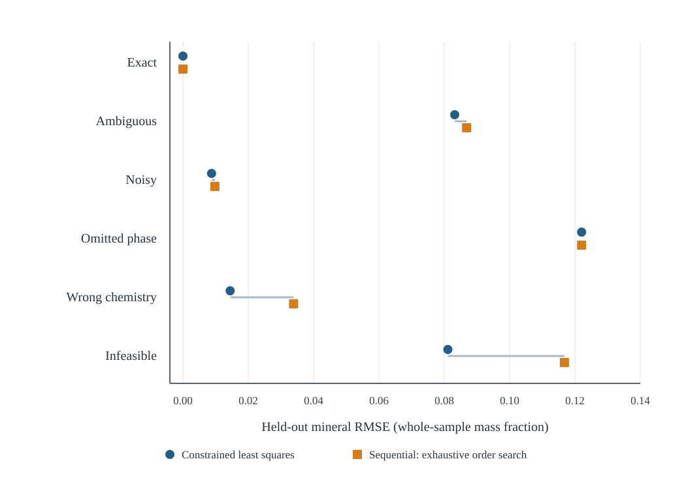
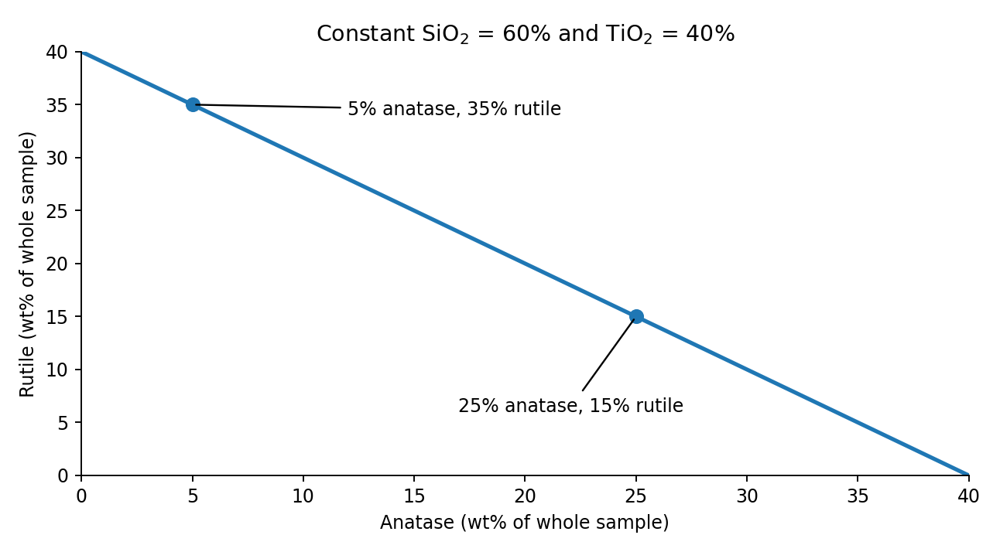

<nav class="article-mobile-outline" aria-label="Article sections">

On this page

<ol>
<li><a class="no-external" target="_self" href="#emc-introduction">Introduction</a></li>
<li><a class="no-external" target="_self" href="#emc-forward">Chemical balance and estimation</a></li>
<li><a class="no-external" target="_self" href="#emc-distributions">Moments and distributional information</a></li>
<li><a class="no-external" target="_self" href="#emc-sequential">Sequential allocation and search</a></li>
<li><a class="no-external" target="_self" href="#emc-design">Experimental design</a></li>
<li><a class="no-external" target="_self" href="#emc-results">Results and interpretation</a></li>
<li><a class="no-external" target="_self" href="#emc-identifiability">Identifiability</a></li>
<li><a class="no-external" target="_self" href="#emc-followup">Mineralogical information</a></li>
<li><a class="no-external" target="_self" href="#emc-empirical">Empirical validation</a></li>
<li><a class="no-external" target="_self" href="#emc-next">Next statistical questions</a></li>
<li><a class="no-external" target="_self" href="#emc-conclusion">Conclusion</a></li>
<li><a class="no-external" target="_self" href="#emc-evidence">Research record</a></li>
</ol>

</nav>

## Introduction {#emc-introduction}

Routine geochemical assays are considerably more numerous than direct mineralogical measurements in many geometallurgical datasets. Element-to-mineral conversion (EMC) offers a way of estimating mineral abundances from bulk chemistry and an assumed set of mineral compositions. This is attractive when mineralogy is needed to interpret an orebody, construct domains or investigate processing behaviour, but mineralogical analyses are too sparse to support those tasks directly.

The inverse calculation is less straightforward than the forward chemical balance. Several mineral assemblages may reproduce the same assay, particularly when phases have similar chemical responses or the mineral inventory is incomplete. Measurement error, variable mineral chemistry and reporting conventions introduce further uncertainty. A numerical solution can therefore be chemically consistent without being a reliable estimate of the phases actually present.

[Part 1](https://clausongeomet.com/writing/posts/element-to-mineral-conversion/) introduced the basic mass balance and the problem of non-unique mineral solutions. The purpose of this second investigation was to examine several related questions. What do constrained least-squares estimators recover under different departures from an ideal mass balance? What happens when minerals are allocated sequentially from a finite chemical inventory, and can a search algorithm explore the resulting order dependence? Can information about the distribution of assays, rather than individual assays alone, help constrain the conversion? Finally, when the bulk chemistry is insufficient, what changes if independent mineralogical observations are introduced?

This was a methodological exploration, not an attempt to demonstrate the superiority of one optimisation algorithm. The initial experiments compare estimators under controlled synthetic conditions, where the generating mineral proportions are known. Separate follow-up experiments examine calibration and phase-sensitive measurements. None constitutes validation on an independently sampled ore deposit.

## 1. From a chemical balance to a mineral estimate {#emc-forward}

For a specimen, let $\mathbf m\in\mathbb R^k$ contain the mineral mass fractions, $\mathbf a\in\mathbb R^p$ the measured analyte mass fractions and $C\in\mathbb R^{p\times k}$ the expected chemical contribution of each mineral to each analyte. The observation model is

$$
\mathbf a=C\mathbf m+\boldsymbol\epsilon, \tag{1}
$$

where $\boldsymbol\epsilon$ denotes analytical error and may also absorb discrepancies from an imperfect fixed-composition model. A physically meaningful solution generally requires $m_j\geq0$. A complete phase inventory may justify $\sum_jm_j=1$; an incomplete inventory may instead require $\sum_jm_j\leq1$, or an explicit unmodelled component. Neither constraint makes unmeasured phases observable by itself.

The main synthetic system contained quartz, hematite, kaolinite and forsterite. Four oxide channels were retained: SiO$_2$, Fe$_2$O$_3$ reported as total iron, Al$_2$O$_3$ and MgO. The frozen idealised response matrix was approximately:

| Assay component | Quartz | Hematite | Kaolinite | Forsterite |
|:--|--:|--:|--:|--:|
| SiO$_2$ | 1.0000 | 0 | 0.4655 | 0.4271 |
| Fe$_2$O$_3$ (total Fe basis) | 0 | 1.0000 | 0 | 0 |
| Al$_2$O$_3$ | 0 | 0 | 0.3950 | 0 |
| MgO | 0 | 0 | 0 | 0.5729 |

These coefficients are drawn from the [frozen simulation fixture](https://github.com/ClausonGeomet/writing/blob/d2f69fe3b4375a4a3dd03ea1ac2cb40149ee8b79/research/emc-part2a/fixtures/manifest.json). The retained components are not a complete accounting of every oxide, hydroxyl or volatile in the minerals. They were not closed to 100% after selection, and an unallocated mass fraction is not automatically a measure of amorphous material.

### Constrained least squares

The natural starting point is to find mineral masses that minimise assay residuals while satisfying the appropriate physical constraints. For a known, positive-definite analytical error covariance $\Sigma_\epsilon$, a general weighted objective is

$$
\hat{\mathbf m}=\underset{\mathbf m\in\mathcal F}{\operatorname{argmin}}
\;(\mathbf a-C\mathbf m)^\mathsf T\Sigma_\epsilon^{-1}(\mathbf a-C\mathbf m), \tag{2}
$$

with $\mathcal F$ denoting the chosen nonnegative and mass-closure feasible set. This expression is a statistical motivation, not a claim that a full field-derived laboratory covariance was estimated in the experiment. The frozen baselines comprised a pseudoinverse, nonnegative least squares (NNLS), diagonally weighted NNLS and constrained least squares with equality or partial closure. The prespecified comparison used equality-constrained least squares, except in the missing-phase scenario, where partial closure was used.

Weighted residuals and closure encode different sources of information. Measurement weights describe the credibility of the laboratory observations; closure describes the assumed completeness of the modelled mineral inventory. The coefficients in $C$ describe mineral chemistry. Treating any of those as an arbitrary tuning device can improve numerical fit without improving geological interpretation.

## 2. Statistical information at the specimen and population scales {#emc-distributions}

One reason for considering statistical methods beyond least squares was that a drillhole or geological domain provides more than an isolated assay. Across a population of specimens, the observed chemistry has a mean, a covariance structure and a distribution. It is reasonable to ask what those properties imply about the unobserved mineral composition distribution.

### Method of moments and the forward model

Let $\boldsymbol\mu_m=\operatorname E[\mathbf m]$ and $\Sigma_m=\operatorname{Cov}(\mathbf m)$. If $C$ is fixed, analytical errors have zero mean and those errors are independent of the mineral abundances, equation (1) gives

$$
\operatorname E[\mathbf a]=C\boldsymbol\mu_m,
\qquad
\Sigma_a=C\Sigma_m C^\mathsf T+\Sigma_\epsilon. \tag{3}
$$

These are the first two population-moment equations. In an ideal setting, observed assay means and covariances could be compared with the corresponding moments implied by a candidate distribution of mineral compositions. This is the method-of-moments idea behind the statistical part of the investigation: rather than treating each assay independently, assess whether a mineral model also reproduces important population-level characteristics.

There are immediate qualifications. Equation (3) is conditional on fixed $C$ and independence of mineral variation and measurement error. If mineral chemistry varies systematically or laboratory errors are correlated with specimen characteristics, additional terms appear. More fundamentally, the equations are usually underdetermined. They map the mineral mean and covariance into chemical moments; they do not generally provide an inverse map back to a unique mineral mean or covariance. Under an accurately known, full-column-rank response and known error covariance, inversion of these moments may be possible in principle. In a rank-deficient mineral system it is not. Mineral closure also constrains the covariance, since $\mathbf1^\mathsf T\Sigma_m=0$ for a fully closed composition.

The distinction between singular-value decomposition (SVD) of $C$ and principal-component analysis (PCA) of the observed assays is relevant here. SVD examines the directions in mineral composition that the assumed chemical system can observe. PCA characterises the dominant directions of variation in the measured assays. Large variation along an assay principal component does not imply that all corresponding mineral phases have been identified. An unobserved mineral contrast can remain invisible even with a large sample and accurately estimated assay covariance.

The completed experiments did not fit a standalone method-of-moments estimator for the latent distribution of mineralogy. Instead, they used the moment relationships as motivation for penalties on differences between the observed and reconstructed *assay* means and covariances. This difference in scope matters: matching observable chemical moments is not the same as identifying latent mineral-distribution parameters.

### KL divergence and the distributional criterion

A second line of investigation concerned distributional agreement. Let $p_b$ and $q_b$ denote probabilities assigned to histogram bin $b$ under observed and reconstructed assays. Kullback–Leibler (KL) divergence is

$$
D_{\mathrm{KL}}(p\Vert q)=\sum_b p_b\log\!\left(\frac{p_b}{q_b}\right). \tag{4}
$$

It measures a directed discrepancy between probability distributions; it is not symmetric, and its value can diverge when a bin has positive observed probability but zero model probability. The implemented Part 2B distribution criterion used the related Jensen–Shannon (JS) divergence, with $h=(p+q)/2$:

$$
D_{\mathrm{JS}}(p,q)=\tfrac12D_{\mathrm{KL}}(p\Vert h)
+\tfrac12D_{\mathrm{KL}}(q\Vert h). \tag{5}
$$

This is a symmetric, finite quantity for the discrete histograms used here. It was evaluated separately for each assay channel using a fixed ten-bin scheme, then averaged over channels. It was not a KL divergence between observed and predicted *mineral* distributions, nor a comparison of full multivariate joint assay densities. The histograms used ten bins with fixed edges at $0,1/8,\ldots,1$ and open-ended outer bins. The bin choices, and use of natural logarithms in the divergence, are part of the scoring definition rather than geological evidence.

The combined training objectives were designed to answer a particular exploratory question: does an allocation order that preserves population-level chemical behaviour behave differently from one selected using only per-specimen assay residuals? The rowwise component $L_{\mathrm{row}}$ was an average squared standardised chemical residual, $L_{\mathrm{row}}=\operatorname{mean}_{s,i}\{[(a_{si}-\hat a_{si})/\sigma_i]^2\}$ (with $\sigma_i=1$ where no error scale was supplied). The expanded criterion was

$$
L_{\mathrm{dist}}=L_{\mathrm{row}}+L_{\mu}+L_{\Sigma}+L_{\mathrm{JS}}, \tag{6}
$$

where $L_\mu$ compared assay means, $L_\Sigma$ compared assay covariance matrices, and $L_{\mathrm{JS}}$ averaged marginal histogram divergences. For example, with $t_i=\max\{\operatorname{sd}(a_i),0.01\}$ calculated on training data, the moment terms had the form

$$
L_\mu=\frac1p\sum_i\left(\frac{\bar a_i-\overline{\hat a}_i}{t_i}\right)^2,
\quad
L_\Sigma=\frac1{p^2}\sum_{i,j}
\left(\frac{S_{a,ij}-S_{\hat a,ij}}{t_it_j}\right)^2. \tag{7}
$$

The auxiliary terms were added with unit coefficients as a fixed exploratory design. They were not derived from a common likelihood, and the relative scales were not estimated from independent mineralogical observations. The score can diagnose whether the reconstructed assay distribution retains selected characteristics of the measured chemistry, but it cannot independently confirm the reconstructed mineralogy. In fact, if the reconstructed assay equals the observation for every training specimen, all three auxiliary terms are already zero: the assay means, covariances and empirical histograms must then agree. The auxiliary terms chiefly change the trade-off when exact per-specimen matching is not obtained.

This limitation is not specific to the histogram method. If two mineral distributions induce the same distribution of observable assays, their assay moments and even their full assay probability laws coincide. No chemical-distribution divergence, including KL divergence, can distinguish them using those observations alone.

## 3. Sequential mineral allocation and the role of search {#emc-sequential}

A separate hypothesis was motivated by rule-based mineral calculations in which candidate phases are assigned chemical components sequentially. [HSC Geo documentation](https://www.metso.com/globalassets/portfolio/hsc-chemistry/84-geo---mineralogical-calculations-and-mineral-database.pdf) describes staged mineralogical rules and residual chemical accounting, while [Whiten (2008)](https://doi.org/10.1080/08827500701257860) provides the identifiability context. The algorithm implemented here was an original, simplified limiting-component allocator. It was not a reproduction of the full HSC implementation or a model of geological formation sequence.

Beginning with nonnegative assay inventory $\mathbf r=\mathbf a$ and remaining whole-sample mass $b=1$, each visited mineral $j$ was allocated the maximum amount compatible with the remaining assay components:

$$
\Delta m_j=\min\left\{b,\min_{i:C_{ij}>0}\frac{r_i}{C_{ij}}\right\}. \tag{8}
$$

The algorithm then updates $\mathbf r\leftarrow\mathbf r-C_{:j}\Delta m_j$ and $b\leftarrow b-\Delta m_j$. An early mineral can consume a component needed by a later mineral, so the final allocations depend on the sequence. The rule also depends on nonnegative inputs and fixed nonnegative chemical coefficients. Its limiting ratios are sensitive to small component concentrations and measurement noise.

### A four-mineral illustration

Consider a hypothetical composition of 45% quartz, 15% hematite, 20% kaolinite and 20% forsterite using the same idealised chemical response matrix. The resulting assay is approximately 62.85% SiO$_2$, 15.00% Fe$_2$O$_3$, 7.90% Al$_2$O$_3$ and 11.46% MgO. The limiting-component rule gives different allocations for two sequences:

| Allocation sequence | Quartz | Hematite | Kaolinite | Forsterite |
|:--|--:|--:|--:|--:|
| Quartz, hematite, kaolinite, forsterite | 0.6285 | 0.1500 | 0 | 0 |
| Kaolinite, forsterite, quartz, hematite | 0.4500 | 0.1500 | 0.2000 | 0.2000 |

The first sequence exhausts the available SiO$_2$ by allocating it to quartz. There is subsequently no SiO$_2$ available for kaolinite or forsterite, despite the measured Al$_2$O$_3$ and MgO. The second order recovers the generating mixture in this illustration. The calculation demonstrates order sensitivity in the chosen greedy rule; it is not another independent result from the frozen simulation and does not imply that the true order would be known for a field sample.

### What was optimised by the genetic algorithm?

With four candidate minerals there are $4!=24$ possible complete sequences. This is small enough for exhaustive enumeration, which was included as a reference for the best value of the specified *training score among the 24 orders*. To explore the behaviour of less exhaustive search, I also compared a fixed lexical order, adjacent-swap greedy search, beam search, random search and a genetic algorithm (GA).

A candidate in the GA was a permutation of mineral names. For each permutation, the same sequential allocation rule was applied to the training assays, and its rowwise or distributional chemical reconstruction score was calculated. The GA used six candidate orders, two elites, order crossover, swap mutation probability 0.3, four generations, and seeds 101–103. The non-exhaustive methods had a common proposal cap of 24, with repeated candidate evaluations cached. The selected order was applied unchanged to held-out assays.

Consequently, this GA did not directly optimise mineral abundances in a continuous feasible region, infer a mineralogical distribution or estimate a Bayesian posterior. Its role was narrower: to explore the order dependence of a particular greedy decoder. Nor does an exhaustive minimum of the *chemical training objective* guarantee minimum mineral error when several mineral compositions fit the chemistry.

A related mathematical result came later in the investigation. If the greedy assignment is generalised so that each mineral can take any freely chosen specimen-specific fraction of its currently feasible maximum, then every permutation reaches the same final resource-feasible set, provided chemical coefficients and resources remain fixed and nonnegative. In that setting, allocation order is redundant for a common objective defined on the final mineral masses. Order can become relevant again under fixed greedy assignments, shared-fraction constraints or genuinely path-dependent rules, but those are additional assumptions. The [formal reachability argument](https://github.com/ClausonGeomet/writing/blob/e460bea3d2e12d621dbe51887cb1bf9c1ab42f4b/research/emc-part2b/prior_guided/MATHEMATICAL_DESIGN.md) sets out its conditions. This was a useful clarification of what the order-search experiment could and could not show.

## 4. Synthetic experimental design {#emc-design}

The first study used the public [simCoDaR package](https://github.com/ClausonGeomet/simCoDaR) to generate mineral compositions and the corresponding theoretical chemical assays. The generator was pinned to commit `d9a0b27676a0cb3a4acb300a3f6b2ebc845d205d`. The purpose of simulation was to retain known mineral truth for evaluation while presenting the fitting algorithms with chemistry only. The simulated XRF/XRD-like outputs should not be mistaken for independently measured laboratory assays and mineralogy.

There were six scenarios with three independently generated replicate cohorts per scenario and 60 specimens per cohort: 1,080 synthetic specimens in total. Each cohort was divided into 30 training, 10 validation and 20 held-out test specimens. The four-mineral system was used in five scenarios; the sixth was a three-mineral ambiguity example. The tested departures from an ideal model were designed to isolate different sources of difficulty.

| Scenario | Experimental change | Question examined |
|:--|:--|:--|
| Exact, identifiable | Four minerals with the correct fixed response matrix and exact assays | Can the method recover an identifiable mixture? |
| Chemically ambiguous | Quartz, anatase and rutile, with identical observed TiO$_2$ responses for the latter two | Can mineral proportions remain uncertain despite an exact assay fit? |
| Noisy assay | Added signed Gaussian assay error to the four-mineral system | How does analytical noise affect recovery and the limiting-component rule? |
| Omitted phase | Forsterite present in the generating mixture but absent from the fitting inventory | How are unmodelled minerals represented by the residual and unallocated mass? |
| Incorrect chemistry | Reduced the fitted kaolinite Al$_2$O$_3$ response relative to its generating value | What happens when the chemical response matrix is wrong? |
| Infeasible chemistry | Inflated the exact assay by 20% | How do methods behave when exact closed mass balance is impossible? |

Part 2A evaluated five mass-balance estimators, producing 5,400 baseline specimen fits. Part 2B evaluated 20 configurations of allocation-search method, training objective and search seed per replicate cohort, giving 360 fitted configurations and 1,080 split-level metric rows. The numerical comparisons reused the same frozen synthetic cohorts and train/validation/test assignments. The order-selection methods saw training assays and the assumed response matrix; generating mineral truth was reserved for retrospective evaluation.

Mineral and assay RMSE were calculated on the held-out specimens. The prespecified exploratory benefit criterion required a mineral-RMSE reduction of at least 0.01 whole-sample mass fraction in two of three matched replicates relative to the designated constrained baseline, with mean assay-RMSE increase no greater than 0.001. This is a descriptive decision rule for the simulation, not a hypothesis test or a universal definition of a meaningful field improvement. Three replicate cohorts cannot provide a general precision or power assessment.

## 5. Results and interpretation {#emc-results}

### Mineral recovery and chemical fit

The following results are mean held-out errors across the three test cohorts (20 specimens each) for the prespecified constrained baseline and the sequential allocator with exhaustive search under the rowwise objective. Entries are whole-sample mass fractions. The full all-seed analysis examines every search method and the separate distribution objective; the table is a readable starting point rather than a favourable subset.

| Scenario | Constrained mineral RMSE | Sequential mineral RMSE | Constrained assay RMSE | Sequential assay RMSE |
|:--|--:|--:|--:|--:|
| Exact, identifiable | 0.000000 | 0.000000 | 0.000000 | 0.000000 |
| Chemically ambiguous | 0.083206 | 0.086836 | 0.000000 | 0.000000 |
| Noisy assay | 0.008752 | 0.009772 | 0.004316 | 0.004978 |
| Omitted phase | 0.122035 | 0.122035 | 0.064301 | 0.064301 |
| Incorrect chemistry | 0.014450 | 0.033874 | 0.005288 | 0.012803 |
| Infeasible chemistry | 0.081103 | 0.116787 | 0.045520 | 0.063043 |

The exact case provided an implementation check: when the response matrix was correct and informative, both classes of method could reproduce the generating composition. In the ambiguous case, both methods reproduced the observed chemistry while retaining appreciable mineral error. The omitted-phase and incorrect-chemistry scenarios produced different kinds of model discrepancy. In the former, the assay demanded material not represented by the fitting mineral list; in the latter, a mineral's assumed chemical contribution was wrong. Neither problem can be fully interpreted from the magnitude of a fitted residual alone.

The order-search exercise did reveal substantial sensitivity to the initial sequence. For the exact case, median mineral-RMSE improvement from a searched order relative to a weak fixed lexical order was about 0.1735. This is a useful finding about the greedy allocator, but it is not a result about new information in the assay: the constrained least-squares baseline was already effectively exact in that case.

Across the saved results, none of the 120 scenario–objective–method–seed comparison groups met the predeclared joint mineral-accuracy and assay-error criterion against the constrained baseline. The 120 groups are related analyses of the same small scenario design, not 120 independent empirical experiments. The observation therefore supports a limited conclusion about these simulation settings and this allocation rule, not a general ranking of optimisation methods.

### Did population-moment and histogram matching change the outcome?

The statistical objective was a genuine part of the experiment, rather than a post hoc interpretation. In addition to rowwise error, it penalised differences between observed and reconstructed assay means, covariances and marginal histogram distributions using equations (5)–(7). This examines whether preserving population summaries changes the order selected on the training data and its behaviour on the held-out set.

Most method/seed combinations produced identical held-out errors under the rowwise and distributional training objectives. The infeasible scenario illustrated a trade-off. Under exhaustive order search, the distribution objective had mineral RMSE 0.080003, compared with 0.116787 for the row objective and 0.081103 for the constrained baseline. But its corresponding assay RMSE rose to 0.097596, compared with 0.063043 for rowwise search and 0.045520 for the baseline. The shift is interesting as an objective-sensitivity result; it did not satisfy the original joint criterion.

The moment and JS terms therefore provided an informative diagnostic of how order selection responds to extra population-level chemical constraints. They did not establish that matching the observed assay distribution identifies the underlying mineral distribution. That question needs independent mineralogical evidence or additional structural assumptions, and the results should not be reinterpreted as tests of a fitted Dirichlet or logistic-normal mineral population model.

### Search behaviour and stochastic variation

The GA results are useful mainly for understanding how the finite search behaved. Against beam search, the joint condition of comparable training score, strictly fewer actual evaluations and shorter measured fit time held in 18 of 54 paired row-objective outcomes and 14 of 54 distribution-objective outcomes. The stricter criterion requiring at least two successful outcomes among three replicate cohorts held in 6 of 18 and 5 of 18 scenario/seed groups, respectively. Against greedy search, the GA recorded no such joint wins. Small absolute runtimes and variation across seeds limit any general inference about computational efficiency.

This analysis neither recommends nor rejects genetic algorithms in general. The practical insight is narrower: with four minerals, there were only 24 possible orders, and the meaning of the optimised objective mattered more to the interpretation than the identity of the search algorithm.

## 6. What moment matching cannot identify {#emc-identifiability}

The simplest example of non-identifiability uses quartz, anatase and rutile, where the last two phases have the same ideal TiO$_2$ chemical response. For measured SiO$_2$ and TiO$_2$,

$$
C=\begin{bmatrix}1&0&0\\0&1&1\end{bmatrix},
\qquad
\mathbf m(t)=\begin{bmatrix}0.60\\t\\0.40-t\end{bmatrix},
\quad 0\leq t\leq0.40. \tag{9}
$$

Every value of $t$ produces the assay $\mathbf a=(0.60,0.40)^\mathsf T$. Here $\operatorname{rank}(C)=2$, and adding a closure row does not increase that rank because the closure equation is the sum of the two assay equations. Rank deficiency does not imply every possible boundary sample is non-unique, but this interior example admits a full interval of feasible phase splits. For example, 60% quartz, 25% anatase and 15% rutile gives the same measured assay as 60% quartz, 5% anatase and 35% rutile. The difference vector $\mathbf v=(0,1,-1)^\mathsf T$ satisfies $C\mathbf v=0$ and $\mathbf1^\mathsf T\mathbf v=0$. It changes neither the assayed chemistry nor mineral closure while it remains within the nonnegative bounds.

The synthetic experiment included 180 paired specimen-level mineral swaps that yielded exactly the same assays. Matching assay means is therefore insufficient; matching covariance is insufficient; matching marginal histograms is insufficient. Even matching the full observed assay probability distribution would be insufficient, because the forward map makes these different mineral compositions observationally equivalent. If $P_a$ and $Q_a$ are identical, their assay KL divergence is zero regardless of how different the underlying mineral distributions are.

The same issue can be expressed in moment terms. Shifting a feasible mean mineral vector by $t\mathbf v$ leaves $C\boldsymbol\mu_m$ unchanged; a feasible change to mineral covariance along $\mathbf v\mathbf v^\mathsf T$ leaves $C\Sigma_m C^\mathsf T$ unchanged because $C\mathbf v=0$. Thus even exact knowledge of the observed first two moments need not identify their mineral counterparts.

This is the crucial statistical limit on the proposed method-of-moments and distribution-matching direction. A larger assay dataset can estimate observable moments more precisely, but cannot recover an unmeasured mineral contrast that lies in the null space of $C$. The next useful question is not simply which discrepancy measure to optimise. It is which additional information, constraint or measurement can justify a choice among the chemically equivalent solutions.

## 7. Follow-up experiments: independent mineralogical information {#emc-followup}

The main synthetic comparison led to two subsequent investigations. They address different questions from the order-search experiment and are reported here as extensions, not extra validation cohorts for Part 2A/B.

### Finite mineralogical calibration

An independent, sparse set of QXRD-like mineral measurements may provide information about the typical abundance and covariance of phases within a geological domain. A separate Quartz–Anatase–Rutile study compared assay-only constrained fitting (A0), a mineralogical centre fitted from independent noisy calibration samples without using the target assay (A1), and assay fitting regularised towards that fitted centre (A2). The last method was a plug-in quadratic regularisation estimator, not a fully calibrated Bayesian posterior. The study used ten synthetic conditions with 50 independent calibration/evaluation cohorts per condition; phase observations remained simulated, not measured in a laboratory.

For a matched variable-quartz condition with 30 calibration specimens, mean held-out mineral mass RMSE was 0.09227 for A0, 0.08454 for A1 and 0.03246 for A2. This illustrated how a relevant mineralogical calibration can guide the unobserved anatase/rutile split while the target assay informs observable chemistry. In a deliberately mismatched calibration condition, however, A2 RMSE increased to 0.17443 versus 0.09208 for A0. The calibration assumption had become misleading. When quartz was fixed and the target assay contained no information about the phase contrast, A1 and A2 were effectively identical.

These results motivate attention to geological population definition, sample independence and prior conflict rather than automatic reliance on a more elaborate regulariser. The [finite-calibration design and results](https://github.com/ClausonGeomet/writing/blob/e460bea3d2e12d621dbe51887cb1bf9c1ab42f4b/research/emc-part2b/prior_guided/FINITE_CALIBRATION_RESULTS.md) contain the complete frozen comparisons.

### Phase-sensitive observations and transfer

The second extension asked whether an observation sensitive to a previously invisible phase contrast adds information that another bulk chemistry measurement cannot. In one synthetic condition, directly measured specimens had mean mineral RMSE of 0.090938 using bulk chemistry, 0.090934 after adding a redundant total-Ti channel and 0.016829 when adding an independent anatase-sensitive channel. Under the assumed simulation error model, the phase measurement observed an additional compositional direction; the redundant total-Ti channel mostly repeated an existing direction.

The study then examined a different estimand: whether measurements purchased on a small pool of specimens improve predictions for separate specimens that receive only bulk assays. With five phase purchases, the mean paired mineral-RMSE improvement relative to purchasing five replicated bulk tests was 0.000292 in an accurate-prior condition and 0.031298 in a prior-mismatch condition. The latter improvement did not eliminate prior harm: phase-updated A2 still had RMSE 0.144813 versus 0.092592 for prior-free A0. These are descriptive results from synthetic cohorts; the direct and independent-unmeasured effects must not be conflated. The [phase-sensitive experimental record](https://github.com/ClausonGeomet/writing/blob/2f172838f8ae3259cbace688551b158447398796/research/emc-part2b/phase_sensitive/RESULTS.md) records the comparison and the limitations of its approximate covariance update.

Together, these experiments support a conditional distinction. Mineralogical observations can provide information absent from the bulk assay, but usefulness for a new specimen depends on whether the calibration population and measurement model transfer to it.

## 8. The missing empirical test {#emc-empirical}

The work remains synthetic. A small number of public data collections were screened for paired whole-rock chemistry and independent mineralogical measurements. None passed the admission requirements for an unexposed, comparable, specimen-level field-validation cohort. The absence of a new empirical benchmark is a limitation of the work, not evidence that the available algorithms have been exhaustively assessed.

The strongest leads included the [CSIRO Fortescue collection](https://data.csiro.au/collection/csiro:6753), which still required review of analytical basis, mineral completeness and independent validation status; a small previously identified Mary–Wildman XRD/XRF set, requiring dry-basis and censoring checks; and the [Cloncurry METAL collection](https://repository.data.auscope.org.au/dataset/cloncurry-metal-multimodal-integrated-mineral-system-characterisation-data), where TIMA volume or surface measurements and surface pXRF could not simply be treated as matched whole-sample mineral mass fractions. The [dataset-screening record](https://github.com/ClausonGeomet/writing/blob/d2f69fe3b4375a4a3dd03ea1ac2cb40149ee8b79/research/emc-part2a/results/dataset_screen.csv) documents these exclusions.

A credible empirical evaluation would need an audited specimen join, consistent analytical and mineral mass bases, a declared phase inventory, treatment of missing/low-abundance phases, mineral chemistry provenance, uncertainty estimates and an untouched grouped evaluation set. Geological domains and the scale of specimen support would need to be recorded. The aim would not be merely to reconstruct chemistry, but to evaluate the accuracy and uncertainty of the mineral quantities needed for a specified geological or metallurgical purpose.

## 9. Statistical questions for the next stage {#emc-next}

The mathematical-statistical direction remains open, but it is more precise after these experiments. One possibility is to model the distribution of mineral compositions explicitly, then propagate it through the chemical response matrix and compare predicted assay moments and distributions with observations. A Dirichlet model on a complete, strictly positive mineral simplex has

$$
\operatorname E[M_j]=\mu_j=\frac{\alpha_j}{\alpha_0},\qquad
\operatorname{Var}(M_j)=\frac{\mu_j(1-\mu_j)}{\alpha_0+1},\qquad
\alpha_0=\sum_j\alpha_j. \tag{10}
$$

Given independent *observed mineral proportions*, one moment-based concentration estimate from phase $j$ is $\hat\alpha_{0,j}=\bar m_j(1-\bar m_j)/s_j^2-1$, with qualifications about sampling variation and model fit. A Dirichlet family imposes a restricted covariance structure and strictly positive support; it will be unsuitable for some structural-zero, mineral-occurrence and geological mixture problems. A logistic-normal model in isometric log-ratio coordinates permits a richer covariance structure on a positive simplex, while requiring a separate treatment of true absences and censored observations. These are possible modelling directions, not procedures fitted in the completed Part 2A/B study.

A corresponding divergence-based model could compare observed assays with the assay distribution implied by simulated mineral populations, perhaps using KL or JS divergence when probability estimation and support are defensible. Repeated simulation draws could estimate stochastic objective values rather than selecting a favourable draw. However, the chemical null-space remains unchanged: without additional information, a fitted assay distribution need not imply a uniquely recovered mineral distribution. Realistic analytical errors, mineral chemistry variation, calibration uncertainty, geological domain structure and validation on independent phase measurements would have to enter the study design.

A separate, as-yet-unexecuted measurement proposal involves 24 independent physical units, independently prepared splits and rereads for paired mineralogical and bulk chemistry analyses, with reference conditions. Its initial purpose would be to separate components of analytical, preparation and sampling variation, not to claim that repeated readings constitute new independent geological units. The proposed size does not guarantee accurate estimation of a high-dimensional covariance matrix or field-scale predictive uncertainty.

This is also where a future Bayesian measurement model might become useful. Such a model would connect phase occurrence, mineral composition, noisy assays, mineralogical observations and geological variation, while making prior assumptions and uncertainty explicit. Bayesian inference can represent uncertainty in an unidentified direction; it cannot turn that direction into new measured information.

## Conclusion {#emc-conclusion}

The initial investigation was motivated by several possible ways to use chemical data more effectively: constrained mass-balance fitting, sequential limiting-component allocation, search over mineral orders, and comparisons of observed and reconstructed assay distributions. The experiments showed that allocation order can strongly affect a fixed greedy rule, but the order-search methods did not satisfy the prespecified improvement criterion against the constrained mass-balance reference in the six synthetic scenarios. Adding assay-moment and marginal-distribution penalties changed some selected solutions, especially under deliberately infeasible chemistry, without resolving the fundamental distinction between chemical agreement and mineral recovery.

The statistical analysis explains why. Population means, covariance matrices and information-theoretic divergences are useful descriptions of the observed assay data. Their relationship to mineralogy is mediated by the response matrix, its null space and the assumptions made about mineral chemistry and mineral distributions. Better estimation of the observed chemical distribution does not, by itself, identify phase distinctions absent from the measurements.

The subsequent calibration and phase-sensitive experiments illustrate what additional information can contribute, alongside the risk of imposing incorrect geological assumptions. The remaining work is empirical: establish reliable, paired mineralogical and chemical observations on a consistent mass basis, characterise their measurement errors, and test inference across independent geological units. That would provide a stronger foundation for evaluating moment-based, distributional and probabilistic EMC methods than further optimisation of a chemically ambiguous objective alone.

## Research record and scope {#emc-evidence}

The main experiments, their frozen inputs, complete method comparisons and numerical corrections are documented in [Part 2A](https://github.com/ClausonGeomet/writing/tree/d2f69fe3b4375a4a3dd03ea1ac2cb40149ee8b79/research/emc-part2a) and [Part 2B](https://github.com/ClausonGeomet/writing/tree/d2f69fe3b4375a4a3dd03ea1ac2cb40149ee8b79/research/emc-part2b). The later [finite-calibration](https://github.com/ClausonGeomet/writing/blob/e460bea3d2e12d621dbe51887cb1bf9c1ab42f4b/research/emc-part2b/prior_guided/FINITE_CALIBRATION_RESULTS.md) and [phase-sensitive](https://github.com/ClausonGeomet/writing/blob/2f172838f8ae3259cbace688551b158447398796/research/emc-part2b/phase_sensitive/RESULTS.md) studies were separately designed and reviewed exploratory synthetic experiments. Reviews were internal, not external peer review; retained historical failed checks and a retrospective phase-study inventory correction remain part of the record. No new scientific experiments were run to prepare this article.

For statistical background, see [Lin (1991), *Divergence measures based on the Shannon entropy*](https://doi.org/10.1109/18.61115) for JS divergence and [Minka, *Estimating a Dirichlet distribution*](https://tminka.github.io/papers/dirichlet/minka-dirichlet.pdf) for Dirichlet parameter estimation.

