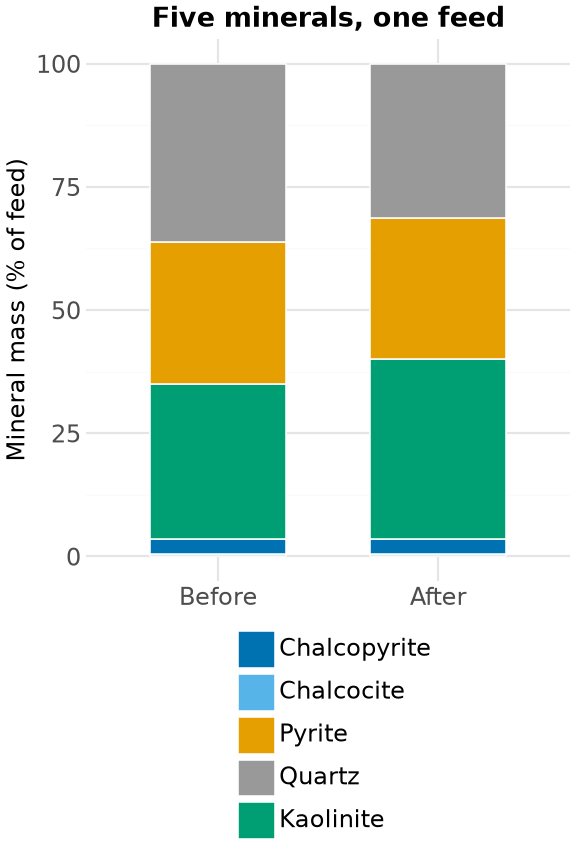

# Finding useful mineral ratios

I was looking at ways to model copper recovery from mineral composition. Two feeds can have similar amounts of copper-bearing minerals but quite different amounts of pyrite, quartz and kaolinite. Those differences could matter to processing. The awkward part is that mineral percentages add to 100, so they cannot all change independently.

That is what drew me to Michael Greenacre's `STEPR` function in R's **easyCODA** package [@coenders2023]. Rather than start with every mineral percentage, it searches for a small set of informative log-ratios. Quartz/Kaolinite, for example, describes quartz relative to clay. Taking the log makes that comparison suitable for regression. With five minerals there are ten possible pairwise ratios; selecting a few makes the resulting model easier to inspect.

This is the R call used in the archived synthetic copper experiment. It searches for up to three ratios using AIC to balance model fit against extra terms. I haven't rerun the selection for this article. The [frozen dataset](materials/examples/copper_v2/copper_v2.csv) supplies `d`.

```r
parts <- c('Chalcopyrite','Chalcocite','Pyrite','Quartz','Kaolinite')
d <- read.csv('materials/examples/copper_v2/copper_v2.csv', check.names=FALSE)
tr <- d$split == 'train'
x <- d[, parts, drop=FALSE]
y <- d$observed_recovery_pct
set.seed(104729L)
step <- easyCODA::STEPR(x[tr,,drop=FALSE], y[tr], method=1,
                        family='gaussian', criterion='AIC', nsteps=3, top=1)
step$names
```

The saved R run selected **Quartz/Kaolinite; Chalcocite/Pyrite; Pyrite/Quartz**. That is a manageable set of relationships to interpret. The first contrasts two gangue minerals; the second puts a copper host relative to pyrite. I wanted to see whether I could get the same selection in Python.

# Porting STEPR to Python

I wrote a limited Python version, `stepr_py`, for the Gaussian stepwise case. Calculating the log-ratios was straightforward. Reproducing the exact order of selected ratios was less so. Two sets of ratios can give almost identical linear predictions while the final selection step chooses a different pair. That matters if I then use those selected ratios as inputs to a forest.

The [parity checks](references/blog-v2-stepr-parity.csv) are from an earlier 240-row example, not the copper dataset below. This reads the archived check results; the [appendix](#port-checks-from-the-earlier-fixture) has the original test details.

```python
import polars as pl
checks = pl.read_csv('references/blog-v2-stepr-parity.csv')
print(checks.select(pl.col('parity_status').value_counts()))
```

Five of the eight strict checks passed. In the other three, Python chose a different **third ratio**, even though the largest difference in OLS predictions was only about $10^{-13}$. The predictions were effectively the same at that precision, but the selection order wasn't. I don't count those as passes. For the copper experiment below, the Python STEPR baselines therefore use **the ratios selected in R**, not an independently verified Python STEPR selection. The [Python source](materials/src/python/stepr.py) and [failure summary](materials/docs/sc023/HISTORICAL_FAILURE_SCOPE.md) are included. The restricted port is not a drop-in replacement for easyCODA.

# A synthetic copper-recovery example

I needed a dataset where I knew what the recovery response ought to be. The example has five minerals. Chalcopyrite and Chalcocite contain copper; Pyrite, Quartz and Kaolinite make up the rest of the feed. The target is **the percentage of contained copper recovered**, not copper grade or the percentage of all feed mass recovered.

I used pinned simCoDaR code to generate the compositions, then applied a separate, deliberately invented recovery rule [@simcodar]. It includes behaviours that are plausible to investigate, but it isn't fitted to plant data.

Here are three training samples. The mineral values are mass percent of the feed; recovery is percent of the copper contained in it. I've rounded the numbers for display.

::: {.specimen-scroll}
| Specimen | Chalcopyrite | Chalcocite | Pyrite | Quartz | Kaolinite | Recovery |
|:---|---:|---:|---:|---:|---:|---:|
| W01_001 | 3.16 | 0.39 | 28.69 | 36.27 | 31.49 | 64.63 |
| W01_002 | 2.93 | 0.46 | 3.58 | 83.44 | 9.58 | 91.79 |
| W01_003 | 1.66 | 2.55 | 6.83 | 62.23 | 26.73 | 88.28 |

: Three frozen training observations. Mineral columns are mass percent; Recovery is observed contained-copper recovery percent. Source: bundled `copper_v2.csv`.
:::

There are 1,024 synthetic samples across 16 generated batches, called worlds. I used 12 worlds (768 samples) for training and kept four (256) for testing. Keeping each world together avoids leaking samples from the same generated batch across the split. These are not 16 real ore deposits.

I also wanted to see what the fitted models do when the feed changes. If I replace **five mass-percentage points of Quartz with Kaolinite**, the total still adds to 100%. The example in @fig-blog-feed shows that replacement for one training sample, before making any recovery prediction.

{#fig-blog-feed fig-alt="Stacked mineral mass bars for W01_001. Before and after each total 100 percent. Quartz falls from 36.27 to 31.27 percent; Kaolinite rises from 31.49 to 36.49 percent; the other three parts stay fixed."}

# Bringing in random forests

The STEPR regression gives a useful, interpretable starting point. But the synthetic recovery rule is deliberately nonlinear: it levels off in places and has an extra penalty when clay and pyrite are both high. A straight-line relationship with the selected ratios won't necessarily pick that up. A random forest can learn bends and interactions without my having to specify each one in advance [@breiman2001].

I also tried a different way of choosing ratios. My `select_lr_ml` function adds ratios according to how much they improve forest predictions on withheld **training worlds**. The final four test worlds are not used for that selection. This is a separate method, not the Python STEPR port. These are the saved training configurations, shown for illustration rather than rerun here:

```r
source('materials/src/R/lr_ml.R')
fit_r <- select_lr_ml(x[tr,,drop=FALSE], y[tr],
  d$world_id[tr], d$inner_fold[tr],
  max_ratios=3, min_improvement=.01, n_trees=50, seed=104729)
fit_r$selected_pairs
```

```python
# The model API requires pandas; this is the narrow input boundary.
import pandas as pd
import sys
from pathlib import Path
sys.path.insert(0, str(Path('materials/src/python').resolve()))
from lr_ml import select_lr_ml
d = pd.read_csv('materials/examples/copper_v2/copper_v2.csv')
parts = ['Chalcopyrite','Chalcocite','Pyrite','Quartz','Kaolinite']
tr = d['split'].eq('train')
fit_py = select_lr_ml(d.loc[tr, parts], d.loc[tr, 'observed_recovery_pct'].to_numpy(),
  d.loc[tr, 'world_id'].tolist(), d.loc[tr, 'inner_fold'].astype(int).tolist(),
  max_ratios=3, min_improvement=.01, n_trees=50, seed=104729)
fit_py['selected_pairs']
```

The saved R and Python forest selectors both picked **Quartz/Kaolinite; Pyrite/Quartz; Chalcopyrite/Chalcocite**. The third ratio compares the two copper-bearing minerals. These are the `select_lr_ml` choices, not the earlier R STEPR selection.

I compared five saved models per language on the same 256 heldout samples (@fig-blog-level). “STEPR + linear” is ordinary least squares (OLS). “STEPR + forest” keeps the ratios selected by R but changes the model. The other comparisons use forest-selected ratios, four ILR coordinates (another representation of relative composition), or four raw mineral percentages.

The forest-selected ratios gave the lowest recovery RMSE in each language, about **1.24 percentage points**. RMSE is the typical prediction error with larger misses penalised more strongly. The R and Python forests are fitted with different engines, so I'm not claiming the fitted trees match. The [full results](#complete-results) show the other methods too.

{#fig-blog-level fig-alt="Observed recovery RMSE on 256 heldout copper rows per fit, in percentage points. R and Python dots are shown for five methods. Selected forest ratios have the lowest saved errors, about 1.24; STEPR linear is about 4.54. Lower is better."}

# What happens when the feed changes?

A low recovery RMSE is encouraging, but it doesn't tell me whether the model responds sensibly to a different mineral mix. The next check was a paired prediction: take the same sample, replace some Quartz with Kaolinite, and subtract the predicted recovery before from the prediction after.

I initially tried `marginaleffects` to do this with the custom model objects. The archived attempts stopped at the interface: R 1.0.0 returned **“Models of class \"lr_ml\" are not supported”** from `predictions()`, and Python 0.6.1 returned **“ValueError Unknown model type”** for the selector dictionary. That says something about my wrappers, not every model supported by those packages. I didn't build a custom adapter. The `paired_contrast` function in the R and Python ratio modules already did what I needed.

The call is almost identical in both languages. Below is the form used for the first heldout copper sample, W13_001. These are **API illustrations, not newly executed predictions**; the [appendix](#paired-call-setup) shows how `fit` and `X` are loaded.

```r
paired_contrast(fit, X, delta=.05, donor='Quartz', recipient='Kaolinite')
```

```python
paired_contrast(fit, X, delta=.05, donor="Quartz", recipient="Kaolinite")
```

The function checks that the mineral fractions still describe a complete feed and recalculates the ratios. The study also applies a separate support check so that both compositions resemble those seen in training.

These are the **archived predictions** for W13_001, not output generated by the two snippets. Both compositions passed that support check. The recovery change is after minus before, in percentage points; it should not be confused with the five-point shift in mineral mass.

| Saved fit, W13_001 | Before recovery (%) | After recovery (%) | Change (pp) |
|:---|---:|---:|---:|
| R selected forest | 87.649 | 87.361 | −0.288 |
| Python selected forest | 87.680 | 87.489 | −0.191 |
| Synthetic noiseless rule | 87.820 | 87.575 | −0.246 |

: Archived W13_001 gated endpoints for the 0.05 Quartz-to-Kaolinite transfer. Model endpoint unit is contained-copper recovery percent; difference unit is pp. The oracle difference is −0.245757 pp. The full frozen-effect table and saved models remain in the private research archive; the [public figure data](assets/blog-v2-effect-direction-input.csv) give the direction counts.

For that sample, the predictions look reasonable. Across all the heldout samples, the picture is less tidy. At the five-point transfer, **235 of 256** samples passed the common support check; 21 were excluded. The synthetic recovery rule decreased recovery in all 235. The selected R forest instead predicted an increase for 44; the Python forest predicted an increase for 37 and effectively no change for four (@fig-blog-direction). The near-zero category is only a numerical threshold, not a measure of uncertainty.

{#fig-blog-direction fig-alt="Predicted direction counts among 235 supported Quartz-to-Kaolinite transfers per fit; 21 starts were excluded. R selected forest: 191 decreases, 44 increases. Python selected forest: 194 decreases, 4 near zero, 37 increases. Both STEPR linear fits: 235 decreases. The noiseless rule decreases in all 235."}

The linear STEPR models predicted a decrease for all 235 supported samples, but their error in the **size** of the change was much larger: **4.009 pp RMSE**, compared with **0.809 pp in R** and **0.850 pp in Python** for the selected forests. It isn't a clean OLS-versus-forest experiment because the selected ratios differ as well. The STEPR forest comparison helps separate those choices. And this is still a test against a synthetic recovery rule, not evidence of what would happen at a plant.

# What I took from it

STEPR was a good starting point because it made the choice of mineral ratios something I could actually inspect. I still haven't fully matched its stepwise selection in Python; three strict tests disagree on the final ratio. That's unfinished work, even if the resulting linear predictions are almost identical.

The random forests did better on recovery RMSE and average transfer-effect error in this fixed synthetic study. But some predicted the wrong direction when Quartz was replaced with Kaolinite. The linear models got that direction right more consistently here, while missing the size by more. I wouldn't choose a model for this sort of question on recovery RMSE alone. I'd also want to check what it predicts when the feed changes.

The [technical appendices](#technical-appendices) have the equations, complete results, earlier example and reproduction details. The findings are about these synthetic data and saved models, not a calibrated plant response or a general ranking of algorithms.

## Technical appendices

::: {#paired-call-setup .callout-note collapse="true"}
## Saved-fit setup for the paired calls

These literal setup snippets define `fit` and `X` for the two short calls above. They load the inner fit from the bundled saved object and select the complete W13_001 composition. The Python model boundary requires a pandas DataFrame. They are examples of the existing API, not a newly executed replay. The table above comes from archived gated endpoint evidence, not console output from these calls.

R setup:

```r
source('materials/src/R/lr_ml.R')
d <- read.csv('materials/examples/copper_v2/copper_v2.csv', check.names=FALSE)
parts <- c('Chalcopyrite','Chalcocite','Pyrite','Quartz','Kaolinite')
fit <- readRDS('materials/examples/publication_sc020/models/SC020-v1/SC020-v1-LF03-R-observed_recovery_pct-select_lr_ml_rf.rds')$fit
X <- d[d$sample_id=='W13_001', parts, drop=FALSE]
```

Python setup:

```python
import pandas as pd
import pickle
from pathlib import Path
import sys
sys.path.insert(0, str(Path('materials/src/python').resolve()))
from lr_ml import paired_contrast
d = pd.read_csv('materials/examples/copper_v2/copper_v2.csv')
parts = ['Chalcopyrite','Chalcocite','Pyrite','Quartz','Kaolinite']
X = d.loc[d.sample_id.eq('W13_001'), parts].copy()
with Path('materials/examples/publication_sc020/models/SC020-v1/SC020-v1-LF03-Python-observed_recovery_pct-select_lr_ml_rf.pkl').open('rb') as stream:
    fit = pickle.load(stream)['fit']
```

:::

::: {#port-checks-from-the-earlier-fixture .callout-note collapse="true"}
## Port checks from the earlier fixture

These checks used the separate archived 240-row fixture and its `y_linear` / `y_nonlinear` responses. The exact historical loop is in [parity.py](materials/examples/copper/parity.py); it called `stepr_py` with Gaussian method 1, AIC or BIC, one or three steps, and `top=1`, then compared oriented selected pairs and heldout OLS predictions with the pinned R reference. The newly copied [eight-row CSV](references/blog-v2-stepr-parity.csv) preserves the original historical bytes.

```python
# Extract from the archived parity.py call; tr is its 180-row training mask.
f = stepr_py(d.loc[tr, parts], d.loc[tr, f"y_{response}"],
             method=1, family="gaussian", criterion=criterion,
             nsteps=nsteps, top=1)
```

| Earlier fixture check | R third ratio | Python third ratio | Maximum prediction difference |
|:---|:---|:---|---:|
| Linear, AIC, 3 steps | Pyrite/Quartz | Chalcopyrite/Pyrite | 2.84 × 10^-14 |
| Nonlinear, AIC, 3 steps | Chalcopyrite/Kaolinite | Chalcopyrite/Quartz | 1.07 × 10^-13 |
| Nonlinear, BIC, 3 steps | Chalcopyrite/Kaolinite | Chalcopyrite/Quartz | 1.07 × 10^-13 |

: Three strict selected-order failures. First two pairs agreed in these rows; all four one-step checks and the linear BIC three-step check passed. Tiny OLS prediction differences do not cure pair-order failure.

## Earlier 240-row saved-model example

The [unchanged R script](examples/read_saved.R), [Python script](examples/read_saved.py) and [launcher](run-examples.sh) give the complete runnable saved-model example in a separately admitted environment. They inspect six heldout W07 compositions from the earlier 240-row design, load each model wrapper’s inner `fit`, and call `paired_contrast` for four doses. This is distinct from W13_001 and every copper result in the main story. For example, the archived R nonlinear selected-forest result for `W07_sample_4` at dose 0.05 is 77.591306% before, 73.522476% after, and −4.068829 pp; the Python result for its own `W07_sample_1` is 80.142649%, 74.830409%, and −5.312241 pp. The full 48 endpoint rows appear below.

## Mathematical details


Let $x=(c_p,c_c,p_y,q,k)$ denote positive mass fractions of Chalcopyrite, Chalcocite, Pyrite, Quartz, and Kaolinite, in that order. Each row is complete, $\sum_j x_j=1$. Closure $C(v)=v/\sum_j v_j$ is a mathematical map; the fitted prediction interfaces take already complete rows and do not silently close arbitrary inputs. A ratio $x_i/x_j$ and its log $z_{ij}(x)=\log x_i-\log x_j$ are dimensionless. An oriented selected pair $(i,j)$ must keep its trained numerator and denominator. The four-coordinate isometric log-ratio basis used for one comparator and the support screen is

$$
z_j(x)=\frac{\sum_{i=1}^{j}\log x_i-j\log x_{j+1}}{\sqrt{j(j+1)}},\qquad j=1,\ldots,4.
$$ {#eq-ilr}

For a fixed saved method $m$, $p_m(x)$ is predicted recovery in percent. Let $d\in\{0,0.01,0.025,0.05\}$ be an *absolute fraction of the whole composition*, with $q>d$. The transfer and paired predictions are

$$
T_d(x)=(c_p,c_c,p_y,q-d,k+d),\quad
\Delta_m(x,d)=p_m(T_d(x))-p_m(x),\quad
\Delta_\mu(x,d)=\mu(T_d(x))-\mu(x).
$$ {#eq-transfer}

Here $\mu$ is the fixed noiseless oracle, when one is defined. The endpoints are percent recovery, while each difference and $e=\Delta_m-\Delta_\mu$ is in percentage points (pp). Thus $d=0.05$ adds five percentage points of total mineral mass to Kaolinite, rather than increasing Kaolinite by five percent of its previous amount. Both endpoints remain closed; no reclosure is applied. This operation changes several log-ratios at once, including $\log(p_y/q)$ and $\log(k/q)$. It is not an independent change in a single covariate.

For level target $t_i$, either observed $y_i$ or noiseless $\mu_i$, and $n$ heldout rows, we use

$$
\operatorname{RMSE}_t=\sqrt{n^{-1}\sum_i[p_m(x_i)-t_i]^2},\quad
\operatorname{MAE}_t=n^{-1}\sum_i|p_m(x_i)-t_i|,\quad
\operatorname{bias}_t=n^{-1}\sum_i[p_m(x_i)-t_i].
$$ {#eq-score}

Effect RMSE replaces the bracketed residual by $e_i$ and uses only eligible paired rows. All three scores are pp. The effect RMSE is a signed-effect error: it squares the difference of signed changes, so it penalizes both size and direction errors. A predicted effect is called diagnostic zero if its absolute value is at most $10^{-8}$ pp; otherwise its sign is negative or positive. Sign agreement compares these three classes with the oracle classes. This numerical band is a reporting rule, not a confidence interval. An excluded specimen has no scored effect and is never counted as zero.

The error in a paired difference equals the error at the transferred endpoint minus the error at the baseline endpoint. A small average baseline-level error can therefore coexist with a larger difference error or a reversed sign. Neither @eq-score nor the selection loss constrains these paired errors to cancel favorably.


## Methods and design details


A world is a seeded batch of synthetic specimens drawn from one fixed target mixture, not an independent geological deposit. In the copper-weighted study, recovery percentage is the designed fraction of contained copper recovered by a hypothetical process, expressed on a 0–100 scale; the illustrative study has separate synthetic recovery formulas. The frozen compositions were historically constructed using pinned simCoDaR source [@simcodar], with equally weighted endmembers and log-ratio variation. “Equal weights” describes target construction, not necessarily equal realized domain counts. The scripts in this article inspect the archived rows; they do not generate them. @tbl-design separates the studies. Their rows are synthetic specimens within constructed worlds, not independent deposits.

| Design | Illustrative two-domain study | Copper-weighted study |
|:---|:---|:---|
| Rows and worlds | 8 worlds × 30 = 240; W01–W06 train (180), W07–W08 test (60) | 16 worlds × 64 = 1,024; W01–W12 train (768), W13–W16 test (256) |
| Endmember targets, in $(c_p,c_c,p_y,q,k)$ order | A $(.12,.06,.12,.50,.20)$; B $(.06,.12,.17,.35,.30)$ | Eight targets: $(c_p,c_c)=(.030,.006)$ or $(.012,.024)$; $p_y=.06$ or $.18$; $k=.12$ or $.28$; $q=1-c_p-c_c-p_y-k$ |
| Construction and noise | Equal target weights; `logratio_sd=0.25`; composition seed $20261029+h$ and response seed $20262029+h$ for world index $h$; separate linear and nonlinear disturbances | Equal target weights; `logratio_sd=0.32`; composition seed $20263029+h$ and response seed $20264029+h$ |
| Training folds | World-constant folds 1,2,3,1,2,3 | World-constant folds $1+((h-1)\bmod 4)$ across training worlds |
| Targets | Observed and noiseless linear and nonlinear recovery, in percent | Observed and noiseless copper-weighted recovery, in percent |
| Saved fits used here | Four selected-ratio forests (two responses × two languages) | Five methods × two languages, all trained to observed recovery |

: Distinct immutable designs.  $h$ is the integer world index. Parameters and seeds document previous construction; no new generation was run. {#tbl-design}

Here and below $I(A)$ is one when condition $A$ is true and zero otherwise. For the illustrative study, let $u=\log(c_p/q)$, $v=\log(c_c/p_y)$, $t=\log(k/q)$ and $S(a)=1/(1+e^{-a})$. The latent logits are $a_L=1.5+0.6u-0.4t$ and [$a_N=1+0.5u-0.5t+0.8\sin(2v)+0.6ut+0.5I(t>\log 0.5)$]{.scroll-math}. For each response, the noiseless value is $100S(a)$ and the observed value is $100S(a+\varepsilon)$ with separate $\varepsilon\sim N(0,0.1^2)$ draws. “Linear” refers to the latent logit formula, not linear recovery in mass fractions.

For the copper-weighted study, write $a=\log(c_p/c_c)$, $b=\log(p_y/q)$ and $c=\log(k/q)$. The designed pressure terms and strict joint gate are

$$
\ell=S(7(c+1.10)),\quad P=S(6(b+1.50)),\quad
J=I(c>-1.10\ \mathrm{and}\ b>-1.50).
$$ {#eq-pressure}

At equality in either gate condition, $J=0$. The designed recovered fractions of copper in Chalcopyrite and Chalcocite are $r_p=S(2.35-0.75\ell-0.28P-0.85J)$ and $r_c=S(2.70-0.55\ell-0.18P-0.55J)$. The mineral copper mass fractions are $u_p=63.546/(63.546+55.845+2(32.065))$ and $u_c=2(63.546)/(2(63.546)+32.065)$, using Cu, Fe and S atomic masses in grams per mole. Thus $\omega=u_pc_p/(u_pc_p+u_cc_c)$ is Chalcopyrite’s share of contained copper. The noiseless recovery percentage is the copper-weighted mean of the two recovered fractions:

$$
\mu(x)=100\{\omega r_p+(1-\omega)r_c\},\qquad
 y=100S\{\operatorname{logit}(\mu/100)+\varepsilon\},\quad \varepsilon\sim N(0,0.08^2).
$$ {#eq-oracle}

$\ell,P,J,r_p,r_c,u_p,u_c,\omega$ are dimensionless; $\mu$ and $y$ are percent. Because noise is inserted before the inverse link, $\mu$ is the noise-free response, not exactly $E(Y\mid X)$. Along @eq-transfer, $c_p,c_c$ and hence $\omega$ are fixed. For $d>0$, $b$ and $c$ increase and $J$ cannot switch off; at $d=0$ they are unchanged. The designed oracle is nonincreasing for this transfer. The reported strict negative signs below are an observation on the eligible rows, not a new global strictness claim. These parameters are illustrative and have no asserted field calibration.

The selected-ratio procedure enumerates each pair with numerator preceding denominator in the five-part order, fits a 50-tree forest to candidate log-ratios, and evaluates pooled group-heldout mean squared loss over world-constant inner folds. It starts from fold-training-mean predictions, accepts a ratio only when $(\mathcal{L}_{old}-\mathcal{L}_{new})/\mathcal{L}_{old}>0$ and at least $0.01$, stops at three ratios or zero old loss, and breaks loss ties within $10^{-12}$ by enumeration order. The seed is 104729, with fold-specific seeds offset by fold ID. This describes the implemented selector and saved configuration; this article does **not** establish a new observation of its historical inner-fold execution. The heldout world score in @eq-score is distinct from that inner selection score. Random forests provide the ensemble baseline [@breiman2001]. The saved forest configuration has 50 trees, seed 104729, bootstrap sampling (replacement with sample fraction 1 in R), all supplied predictors eligible at each split (`mtry=p` in R; `max_features=1.0` in Python), and one thread. R ranger [@wright2017] uses `min.node.size=5`, a minimum node size governing splitting; Python scikit-learn uses `min_samples_leaf=5`, a minimum leaf size. These distinct controls do not make the fitted forests identical.

The copper comparison includes the R easyCODA STEPR pairwise-log-ratio selection [@coenders2023] with ordinary least squares (OLS) and forest learners. Its configured call uses Gaussian `method=1`, AIC, `nsteps=3`, and `top=1` with unrestricted candidate pairs. The Python STEPR baselines reuse the R selected pairs and compute their own saved OLS coefficients; they do not execute Python STEPR selection. The other methods are the greedy selected-ratio forest, a forest on all four @eq-ilr coordinates, and a forest on the first four raw parts (Kaolinite omitted). All five methods per language use the same training response and heldout worlds. OLS uses its saved projection and coefficients; no new rank decision or fit is made.

| Saved copper method | Ordered retained ratios / predictors |
|:---|:---|
| Selected-ratio forest | Quartz/Kaolinite; Pyrite/Quartz; Chalcopyrite/Chalcocite |
| STEPR OLS and STEPR forest | Quartz/Kaolinite; Chalcocite/Pyrite; Pyrite/Quartz |
| ILR forest | Four fixed coordinates of @eq-ilr |
| Raw-part forest | Chalcopyrite; Chalcocite; Pyrite; Quartz |

: Actual saved copper-method features in both languages; ratio orientations are numerator/denominator. The selected forest versus STEPR OLS changes both features and learner. The STEPR forest holds the STEPR ratio set while changing learner. {#tbl-features}

Copper-study transfer eligibility requires $q>d$ and both endpoints inside an empirical training-composition screen. In four ILR coordinates, each query must lie within the inclusive training coordinate minima and maxima, and its fifth-nearest training-row distance must not exceed the radius formed by the empirical 95th percentile of training rows' fifth-nearest *other*-row distances. Write the ordered training fifth-*other*-neighbor distances as $h_{(1)}\le\cdots\le h_{(n_{train})}$; the radius is exactly $\rho=h_{(\lceil0.95n_{train}\rceil)}$, the 730th ordered distance for 768 training rows, without interpolation. Both coordinate bounds and the radius inequality are inclusive. Euclidean distance is preserved by orthonormal rotation, but the axis-aligned coordinate box generally changes with the chosen ILR basis. This is an in-sample geometric screen, not proof of geological feasibility. At $d=.05$, the same 235 of 256 heldout starts pass for every method and language; 21 are excluded.


## Complete results


@tbl-copper contains every saved method-language cell, including less favorable rows. Every level RMSE uses the same 256 W13–W16 specimens and the observed or noiseless percent target. Every effect RMSE and sign count uses the common 235 eligible starts at $d=.05$; the other 21 of 256 are unscored. The oracle has 235 negative, zero diagnostic-zero, and zero positive effects on the eligible set. A zero prediction count is a numerical sign category, not an exclusion count.

| Language | Saved method | Observed level RMSE (pp) | Noiseless level RMSE (pp) | Effect RMSE (pp) | Predicted negative / zero / positive |
|:---|:---|---:|---:|---:|---:|
| R | STEPR OLS | 4.539493 | 4.542968 | 4.008937 | 235 / 0 / 0 |
| R | STEPR forest | 1.721892 | 1.213013 | 0.996582 | 180 / 0 / 55 |
| R | Selected-ratio forest | 1.238594 | 0.636981 | 0.808736 | 191 / 0 / 44 |
| R | Four-coordinate ILR forest | 2.043840 | 1.883924 | 2.046224 | 202 / 0 / 33 |
| R | Raw-part forest | 2.431960 | 2.065901 | 2.438687 | 193 / 0 / 42 |
| Python | STEPR OLS | 4.539493 | 4.542968 | 4.008937 | 235 / 0 / 0 |
| Python | STEPR forest | 1.622204 | 1.137688 | 0.964596 | 187 / 1 / 47 |
| Python | Selected-ratio forest | 1.226601 | 0.624346 | 0.850051 | 194 / 4 / 37 |
| Python | Four-coordinate ILR forest | 2.242901 | 2.134554 | 2.326295 | 215 / 2 / 18 |
| Python | Raw-part forest | 2.798090 | 2.470909 | 2.639857 | 194 / 14 / 27 |

: Complete fixed copper-study comparison. RMSE values are rounded to six decimals; the underlying archived CSV retains full precision. Models trained to observed recovery. Level $n=256$ per row; effect $n=235$ per row after common both-endpoint support, with 21 excluded starts. Predicted signs use the $10^{-8}$ pp zero band. {#tbl-copper}

Within each language's five saved fits, the selected-ratio forest has the lowest observed level RMSE and lowest finite-effect RMSE. Nonetheless, against 235 negative oracle effects, its R predictions are positive on 44 and its Python predictions are positive on 37 and diagnostically zero on four. STEPR OLS predicts 235 negative directions in both languages but has about 4.009 pp effect RMSE versus about 0.809 pp (R) and 0.850 pp (Python) for the selected forest. The comparison displays a direction–magnitude tension in these fixed predictions; it is not an inferential ranking of algorithms. The level columns score all starts, while the effect column scores screened pairs, so their numerical sizes are not interchangeable risks.

[Open the copper effects image at full size](assets/lf03_effects.png).

![Archived copper-study (LF03) finite predicted effects versus transfer dose. The internal labels mean `ilr_rf` = four-coordinate ILR forest, `raw_rf` = raw-part forest, `select_lr_ml_rf` = selected-ratio forest, `stepr_ols` = STEPR OLS and `stepr_rf` = STEPR forest. Vertical values are predicted changes in pp. Colour denotes the sign of error $\Delta_{pred}-\Delta_{oracle}$ under the plot’s own inclusive $10^{-8}$ pp near-zero error band; it does not denote the predicted-effect sign class, whose diagnostic zero band is $10^{-8}$ pp. The input has 10,240 method–language–dose–specimen rows over four doses; 730 excluded rows remain in that input but are omitted from plotted panels. At dose .05, 21 starts per method-language cell are excluded and the table scores the common 235 supported starts. Point overlap prevents reliable sign counting by eye; @tbl-copper is primary. Exact image and input were copied without regeneration.](assets/lf03_effects.png){#fig-lf03-effects}


## Complete illustrative endpoints


The four saved illustrative-study fits have similar observed level RMSEs (2.394–2.899 pp), while their noiseless scores differ more. Each row below uses the same 60 W07–W08 heldouts; observed and noiseless columns are different targets, not repeated fits. No five-method ranking is claimed for this study.

| Fitted response | Language | Observed RMSE (pp) | Noiseless RMSE (pp) |
|:---|:---|---:|---:|
| Linear | R | 2.394434 | 0.950268 |
| Linear | Python | 2.482968 | 0.811697 |
| Nonlinear | R | 2.899339 | 2.791151 |
| Nonlinear | Python | 2.815037 | 2.838184 |

: Pooled heldout recovery-level errors for four fixed saved illustrative-study fits, each on $n=60$; values rounded to six decimals. {#tbl-lf01-level}

The full 48-row endpoint table is in the appendix (@tbl-lf01-dose). It covers the same six distinct W07 specimens under two language-specific fits and four doses, not 48 independent specimens. All 48 archived rows have `component_range_warning=false`; that component-range check differs from the copper study's both-endpoint ILR support screen.


[Open the illustrative dose image at full size](assets/lf01_dose.png).

{#fig-lf01-dose}


## Reproducibility and historical scope

### Earlier discussion

The paired error identity explains why the selected forest's low level RMSE does not secure effect direction. A forest's piecewise-constant predictions may plausibly yield flat or abrupt finite differences; that is an interpretation of its function class, not an isolated causal explanation of the 44 and 37 positive effects here. The oracle's monotone design along the defined transfer supplies the reference direction for this fixed synthetic case. The OLS comparator's all-negative signs coexist with its substantially larger magnitude error, so sign agreement alone is not enough either.

The selected basis, forest library, fitted trees, worlds, and 0.05 dose are all fixed. An invertible coordinate change preserves information but can change axis-aligned tree partitions; likewise, dropping Kaolinite from the raw-part learner changes its coordinate representation. The observed ranking cannot establish a general representation advantage. The R and Python fits share compositions but are distinct fitted objects and learners. We have no sampling uncertainty interval, independent mixture replication, or estimate of model-selection uncertainty. The empirical support screen controls which archived pairs enter the effect score; it does not validate a physical intervention. Neither the hypothetical mass transfer nor an observed association identifies a field causal effect.

### Earlier limitations

The synthetic formulas were chosen for demonstration rather than calibrated to ore processing. The 0.05 result is conditional on the frozen world mixture, train/test split, fitted methods, and support rule. The noiseless target is not the conditional expectation of the noisy response. Only an archived current reference is bound here; identity with every earlier unsaved fit is unestablished. Current historical inner cross-validation execution is not independently observed in this article. R and Python forest controls differ, and exact cross-language fit parity is not claimed. The Python STEPR baselines import actual R selected pairs rather than proving Python STEPR order parity.

Future independent mixtures, prospectively defined transfer grids, and constrained or smooth learners could test whether direction reliability changes. Those are proposals, not experiments or results in this article. Any field use would require external compositions, process calibration, and a separate causal design.

### Historical provenance

This public article is an applied account of a bounded synthetic study. The complete frozen-model and verification archives remain private. In the accompanying source snapshot, the first design is named LF01 and the copper-weighted design LF03; the immutable reference ID is SC020-v1. The science admission commit is `657d64afa1d53a803a7be92bef4253f36177c3bf`; the later documentation starting point is `0bd0b4ba22c14660e693d9a016d4490d0a1caf2b`. Their identities serve different purposes. A registry binds 14 saved model objects and metadata, four for the illustrative study and ten for the copper study. The scripts require those files and an already admitted root, and write only to a reader-chosen output directory. See the [public reader notes](README.md) for available code and data, environment requirements and what remains private. The private claim-to-evidence register binds numbers and copied figures to frozen files. Public R/Python source files have a GPL-3.0 licence, separate from article prose.

Historical boundaries remain recorded. Three strict Python STEPR selected-order tests failed, and an older R integration test and Python finalizer test failed; those paths have not been rerun here or relabelled as passes. Earlier provenance, adapter, and warning-lineage gaps retain their recorded unresolved scopes. Independent saved-reference verification was accepted with notes: a ten-call authoring runtime of 2,855.286969 seconds exceeded its 1,800-second cap (failure retained but judged nonblocking for this bounded reference), and a failed materialization returned process exit 1 although its JSON reported `true_exit=2` (both blocked). The later successful independent path exited 0/0/0 under its recorded controls; this article does not rerun it. Full LF02 denotes excluded software-acceptance work that remains blocked; LF04 is an unexecuted future-study design with no sign-reliability result. These procedural facts constrain reuse and publication; they do not add scientific observations to @tbl-copper.


### Archived saved-model checks and precision


The figures and selected synthetic inputs are linked here. Archived model-execution scripts are provided for inspection but require saved models and an admitted environment not included in this public release.

The complete [archived R script](examples/read_saved.R), [archived Python script](examples/read_saved.py), and [archived launcher](run-examples.sh) are the executable forms. They take the supplied source snapshot, an already admitted read-only installed root, and a new output directory. Both scripts inspect the archived 240-row composition CSV, assert five ordered positive parts, closure within $10^{-10}$, and the 180/60 split. They bind the saved model by registry ID and object hash, unwrap its inner `fit`, predict six W07 specimens, call the actual paired API at four doses, and compare every resulting endpoint and difference with archived rows. The following six excerpts are literal contiguous script bodies; their setup and output writing are in the linked scripts.

The R path first adds the admitted library and checks that ranger and jsonlite namespaces resolve there. This setup is part of the runnable script, including a clean R process; the level-prediction step is:

```r
wrapper <- readRDS(model_file)
fit <- wrapper$fit
stopifnot(identical(unname(lapply(fit$selected_pairs,unname)),unname(lapply(entry$selected_pairs,unlist))))
source(file.path(REPO,'src/R/lr_ml.R'))
fixture <- read.csv(file.path(REPO,'examples/copper/copper.csv'), check.names=FALSE)
stopifnot(nrow(fixture)==240L, identical(names(fixture[,parts,drop=FALSE]),parts), all(fixture[,parts]>0), all(abs(rowSums(fixture[,parts])-1)<=1e-10), sum(fixture$split=='train')==180L, sum(fixture$split=='test')==60L)
ids <- paste0('W07_sample_',c(4,9,10,1,2,3))
rows <- fixture[match(ids,fixture$sample_id),,drop=FALSE]
stopifnot(identical(rows$sample_id,ids))
x <- rows[,parts,drop=FALSE]
levels_pct <- predict_lr_ml(fit,x)
```

The Python path uses the registry-bound pickle and the same API in a different order of the same six specimen IDs:

```python
with model_file.open('rb') as stream:
    wrapper = pickle.load(stream)
fit = wrapper['fit']
assert [list(p) for p in fit['selected_pairs']] == entry['selected_pairs']
fixture = pd.read_csv(repo / 'examples/copper/copper.csv')
assert len(fixture) == 240 and list(fixture.loc[:, parts].columns) == parts
assert (fixture.loc[:, parts] > 0).all().all()
assert ((fixture.loc[:, parts].sum(axis=1) - 1).abs() <= 1e-10).all()
assert fixture['split'].value_counts().to_dict() == {'train': 180, 'test': 60}
ids = ['W07_sample_1', 'W07_sample_2', 'W07_sample_3', 'W07_sample_4', 'W07_sample_9', 'W07_sample_10']
rows = fixture.set_index('sample_id').loc[ids]
X = rows.loc[:, parts].copy()
levels_pct = predict_lr_ml(fit, X)
```

The paired calls are executed by these literal loop bodies from the full scripts. The archived rows are checked after each actual model call.

```r
for (dose in c(0,.01,.025,.05)) {
  contrast <- paired_contrast(fit,x,delta=dose,donor='Quartz',recipient='Kaolinite')
  frozen <- D[D$language=='R' & D$dose_token==as.character(dose),]
  frozen <- frozen[match(ids,frozen$sample_id),]
  stopifnot(identical(frozen$sample_id,ids),max(abs(contrast$before-frozen$before),abs(contrast$after-frozen$after),abs(contrast$contrast-frozen$effect))<=1e-10)
  stopifnot(max(abs(contrast$contrast-(contrast$after-contrast$before))) <= if (dose==0) 1e-12 else 1e-10)
  if (dose==0) stopifnot(max(abs(contrast$contrast),abs(contrast$after-contrast$before))<=1e-12)
  n <- n+1L
  result_rows[[n]] <- data.frame(sample_id=ids,dose_token=as.character(dose),dose=dose,before_percent=contrast$before,after_percent=contrast$after,effect_pp=contrast$contrast)
}
```

```python
for dose in (0, .01, .025, .05):
    result = paired_contrast(fit, X, delta=dose, donor='Quartz', recipient='Kaolinite')
    frozen = D[(D.language == 'Python') & (D.dose_token == ('0' if dose == 0 else str(dose)))].set_index('sample_id').loc[ids]
    for sid, row in result.iterrows():
        expected = frozen.loc[sid]
        assert max(abs(row.before-float(expected.before)), abs(row.after-float(expected.after)), abs(row.contrast-float(expected.effect))) <= 1e-10
        assert abs(row.contrast - (row.after - row.before)) <= (1e-12 if dose == 0 else 1e-10)
        if dose == 0:
            assert abs(row.contrast) <= 1e-12 and abs(row.after-row.before) <= 1e-12
        records.append({'sample_id': sid, 'dose_token': '0' if dose == 0 else str(dose), 'dose': dose, 'before_percent': row.before, 'after_percent': row.after, 'effect_pp': row.contrast})
```

These loops make the actual `paired_contrast(fit, ..., delta=dose, donor='Quartz', recipient='Kaolinite')` calls at four doses. The R return column is `contrast`; Python also returns `contrast`. Both return `before` and `after` in percent. They write `lf01_predictions.csv` with six rows per dose and language; the scripts verify frozen endpoint and effect values with inclusive absolute $10^{-10}$ pp comparisons, paired arithmetic to $10^{-10}$ pp at positive doses, and zero-dose effect and endpoint identity to the separate inclusive $10^{-12}$ pp bound. For the R fit, the oriented selected pairs are Quartz/Kaolinite, Chalcocite/Pyrite and Chalcopyrite/Kaolinite. Its first complete W07 sample 4 is $(0.167239,0.066549,0.072314,0.448685,0.245213)$ in the stated part order; transferring 0.05 gives $(0.167239,0.066549,0.072314,0.398685,0.295213)$. The saved fit predicts 77.591306% before and 73.522476% after, a $-4.068829$ pp change. The Python fit retains the same oriented pairs; its first W07 sample 1 predicts 80.142649% before and 74.830409% after, a $-5.312241$ pp change. These six-decimal displays came from saved-model calls using double values; the archived evidence and the scripts' output CSVs are separate decimal representations. For the probed R sample 4 at dose 0.05, replay and archived CSV readback agree bit for bit, while default `write.csv` followed by `read.csv` changes the before value by `+4.2632564145606011e-14` percent and the effect by `+2.6645352591003757e-15` pp; after is unchanged. Comparisons use the original unrounded bound above, rather than requiring identical CSV readback bits. Both fits use the same six IDs in different display orders.

The copper evaluation also executes the following short arithmetic sections. `a` in R and `L` in Python are the keyed level rows; `good` is the eligible subset of R `b` or Python `F`; the complete scripts enforce row counts, IDs, model identity, null exclusions and oracle signs before these lines.

```r
  pred_sign <- ifelse(abs(good$Delta_pred)<=1e-8,'zero',ifelse(good$Delta_pred<0,'negative','positive'))
  n <- n+1L
  result[[n]] <- data.frame(language=language,method=method,n_level=256,n_effect=235,excluded=21,
    observed_rmse_pp=sqrt(mean((a$pred-a$observed)^2)),noiseless_rmse_pp=sqrt(mean((a$pred-a$noiseless)^2)),
    effect_rmse_pp=sqrt(mean((good$Delta_pred-good$Delta_oracle)^2)),
    negative=sum(pred_sign=='negative'),zero=sum(pred_sign=='zero'),positive=sum(pred_sign=='positive'))
```

```python
        obs = math.sqrt(sum((float(r['pred'])-float(r['observed']))**2 for r in L)/256)
        quiet = math.sqrt(sum((float(r['pred'])-float(r['noiseless']))**2 for r in L)/256)
        err = math.sqrt(sum((float(r['Delta_pred'])-float(r['Delta_oracle']))**2 for r in good)/235)
        signs = [sum(('zero' if abs(float(r['Delta_pred'])) <= 1e-8 else ('negative' if float(r['Delta_pred']) < 0 else 'positive')) == label for r in good) for label in ('negative', 'zero', 'positive')]
        assert all(float(r['Delta_oracle']) < -1e-8 for r in good)
```

For the copper table, both scripts read *frozen* level and effect rows, match the 256 specimen IDs and one model ID within each method-language cell, retain only 235 `SUCCESS` effects, and calculate @eq-score directly. They check the 21 `OFF_SUPPORT` effects have missing predictions and errors. This is arithmetic on admitted saved evidence, not a fresh copper-model replay. Its output `lf03_table.csv` has the ten rows below.


## Complete illustrative-study endpoint table

| Language | W07 specimen | Transfer fraction | Before (%) | After (%) | Change (pp) |
|:---|:---|---:|---:|---:|---:|
| R | W07_sample_4 | 0.000 | 77.591306 | 77.591306 | 0.000000 |
| R | W07_sample_9 | 0.000 | 69.365501 | 69.365501 | 0.000000 |
| R | W07_sample_10 | 0.000 | 87.524484 | 87.524484 | 0.000000 |
| R | W07_sample_1 | 0.000 | 80.148514 | 80.148514 | 0.000000 |
| R | W07_sample_2 | 0.000 | 59.384352 | 59.384352 | 0.000000 |
| R | W07_sample_3 | 0.000 | 51.709498 | 51.709498 | 0.000000 |
| R | W07_sample_4 | 0.010 | 77.591306 | 76.707463 | -0.883842 |
| R | W07_sample_9 | 0.010 | 69.365501 | 67.135421 | -2.230080 |
| R | W07_sample_10 | 0.010 | 87.524484 | 85.446468 | -2.078016 |
| R | W07_sample_1 | 0.010 | 80.148514 | 76.708865 | -3.439649 |
| R | W07_sample_2 | 0.010 | 59.384352 | 57.192621 | -2.191732 |
| R | W07_sample_3 | 0.010 | 51.709498 | 49.206622 | -2.502875 |
| R | W07_sample_4 | 0.025 | 77.591306 | 75.934667 | -1.656639 |
| R | W07_sample_9 | 0.025 | 69.365501 | 66.775734 | -2.589767 |
| R | W07_sample_10 | 0.025 | 87.524484 | 82.605303 | -4.919181 |
| R | W07_sample_1 | 0.025 | 80.148514 | 75.857466 | -4.291048 |
| R | W07_sample_2 | 0.025 | 59.384352 | 54.138426 | -5.245926 |
| R | W07_sample_3 | 0.025 | 51.709498 | 47.438421 | -4.271076 |
| R | W07_sample_4 | 0.050 | 77.591306 | 73.522476 | -4.068829 |
| R | W07_sample_9 | 0.050 | 69.365501 | 68.348942 | -1.016559 |
| R | W07_sample_10 | 0.050 | 87.524484 | 80.297633 | -7.226851 |
| R | W07_sample_1 | 0.050 | 80.148514 | 76.107368 | -4.041146 |
| R | W07_sample_2 | 0.050 | 59.384352 | 51.391997 | -7.992356 |
| R | W07_sample_3 | 0.050 | 51.709498 | 43.153167 | -8.556331 |
| Python | W07_sample_1 | 0.000 | 80.142649 | 80.142649 | 0.000000 |
| Python | W07_sample_2 | 0.000 | 59.641620 | 59.641620 | 0.000000 |
| Python | W07_sample_3 | 0.000 | 54.352191 | 54.352191 | 0.000000 |
| Python | W07_sample_4 | 0.000 | 78.585543 | 78.585543 | 0.000000 |
| Python | W07_sample_9 | 0.000 | 69.205842 | 69.205842 | 0.000000 |
| Python | W07_sample_10 | 0.000 | 87.522289 | 87.522289 | 0.000000 |
| Python | W07_sample_1 | 0.010 | 80.142649 | 77.397245 | -2.745404 |
| Python | W07_sample_2 | 0.010 | 59.641620 | 57.123628 | -2.517992 |
| Python | W07_sample_3 | 0.010 | 54.352191 | 50.557221 | -3.794970 |
| Python | W07_sample_4 | 0.010 | 78.585543 | 78.121765 | -0.463778 |
| Python | W07_sample_9 | 0.010 | 69.205842 | 67.192279 | -2.013562 |
| Python | W07_sample_10 | 0.010 | 87.522289 | 85.612544 | -1.909745 |
| Python | W07_sample_1 | 0.025 | 80.142649 | 77.397245 | -2.745404 |
| Python | W07_sample_2 | 0.025 | 59.641620 | 55.402199 | -4.239421 |
| Python | W07_sample_3 | 0.025 | 54.352191 | 49.291070 | -5.061120 |
| Python | W07_sample_4 | 0.025 | 78.585543 | 77.522330 | -1.063213 |
| Python | W07_sample_9 | 0.025 | 69.205842 | 66.425992 | -2.779850 |
| Python | W07_sample_10 | 0.025 | 87.522289 | 80.780601 | -6.741688 |
| Python | W07_sample_1 | 0.050 | 80.142649 | 74.830409 | -5.312241 |
| Python | W07_sample_2 | 0.050 | 59.641620 | 49.720288 | -9.921332 |
| Python | W07_sample_3 | 0.050 | 54.352191 | 42.786581 | -11.565610 |
| Python | W07_sample_4 | 0.050 | 78.585543 | 73.826089 | -4.759454 |
| Python | W07_sample_9 | 0.050 | 69.205842 | 67.253389 | -1.952452 |
| Python | W07_sample_10 | 0.050 | 87.522289 | 79.243846 | -8.278443 |

: Actual saved nonlinear selected-forest predictions for six W07 specimens at each of four doses in each language. Endpoint unit percent; paired change unit pp. The same six W07 specimens are evaluated by two language-specific fitted models at four doses, giving 48 paired predictions; these are not independent replicates. All 48 have no component-range warning. {#tbl-lf01-dose}

:::
