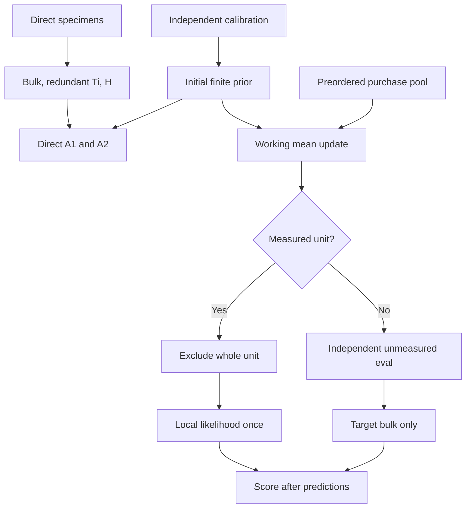

# Mathematical design — prospective frozen study

## Independently sufficient observable contract: qar-phase-v1

Mass order is Quartz,Anatase,Rutile (Q,A,R); all quantities are whole-sample fractions. Bulk channel order SiO2,TiO2. C=[[1,0,0],[0,1,1]], h=(0,1,0), t=(0,1,1). b=(1/3,1/3,1/3); U has columns (2,-1,-1)/sqrt(6),(0,1,-1)/sqrt(2). F={m>=0,1'm=1}; hard support F_H additionally sets A=0. Soft and full groups use F. Optional fixed_quartz is an API compatibility fixture, not a study factor. Signed observations remain unchanged; noisy fitting never imposes Cm<=a.

For D of size p x 3, observation y of length p, known laboratory covariance R SPD, J0=(y-Dm)'R^-1(y-Dm)/2. A0 globally minimizes J0 on the declared F, selecting minimum Euclidean norm among all exact minimizers (no ridge). A1 returns the fitted center without target observations. A2 globally minimizes J0+lambda(m-mu)'K(m-mu)/2 on the same F; lambda>=0, and lambda=0 has A0's tie rule. No GA, local optimizer proxy, truth tuning or posterior-calibration claim.

Initial prior mathematical contract: for n>=2 raw noisy calibration rows Y, ybar=mean(Y), S=cov(YU,ddof=1), Rz=U'Rcal U. Eigendecompose S-Rz; floor its eigenvalues at 1e-4 to obtain G. T=.75G+.25 trace(G)I2/2; M0=(T+Rz)/n; K=U(T+M0)^-1U'. Center mu0 is Euclidean projection of ybar onto the declared center support. Preserve raw mean/covariance, pre/post floor eigenvalues, projection distance. This reuses the accepted covariance model, with no covariance-family change. T is intrinsic specimen variation, M0 approximate finite-calibration mean uncertainty; covariance-parameter uncertainty is not integrated.

Soft wrong-occurrence: project center onto F_H, retain the same finite unrestricted T/M0, but allow all m in F in updates/predictions. A=0 is a preferred center, not a structural-zero probability, atom, infinite penalty or exclusion. Hard control uses the identical center/T/M0 but F_H for updates/predictions. Full/soft vs hard is an explicitly different model assumption, not an equal-feasibility algorithm comparison. Weak prior changes prediction lambda only, not update precision.

Working domain-mean update estimand: each purchased independent UNIT contributes one stack (unit_id,L_i,y_i,R_i). Let A_i=L_i U, V_i=A_i T A_i'+R_i, P=M0^-1+sum A_i'V_i^-1 A_i, v=M0^-1 U'(mu0-b)+sum A_i'V_i^-1(y_i-L_i b). Updated center is b+Uz where z minimizes z'Pz/2-v'z subject to b+Uz in the declared feasible set. M=P^-1, K=U(T+M)^-1U'; hold T fixed. Empty updates preserve initial fitted arrays. This is a bounded plug-in convex mean update, NOT calibrated posterior inference: M is an unconstrained working mean covariance; projection, logistic-normal mass nonnormality and covariance estimation uncertainty are unintegrated. Intrinsic covariance induces cross-channel/cross-repeat terms within V even when lab errors are independent. Do not treat repeated tests of a specimen as independent geological samples.

For measured specimen i exclude its ENTIRE stack (bulk plus new measurements) from its own update, then use its local observations once in its likelihood. A1 measured predictions also use that LOO center. For independent unmeasured eval specimens use all purchased units in the update and only that target's bulk in its likelihood. Calibration, direct-stage specimens, pool and eval are disjoint. Selection is fixed before observations. Truth is used only after prediction for scoring; initial fitting/update/acquisition never consume it. Duplicate unit IDs are invalid.

Information: return ranks/singular values of D, [D;1'], and whitened D U with W'W=R^-1. Singular values descending, rank threshold 1e-10*max(1,smax). Also return rank on the declared support tangent (hard dimension1, full dimension2). Full-rank prior precision is not chemical rank. C and [C;t] leave (0,1,-1) unobserved; [C;h] does not.

LP: minimize/maximize each m_j on F intersect {|Dm-y|<=d}, d_j=3sqrt(R_jj); exclude the prior. Empty sets return infeasible_envelope and null bounds; numerical LP failure is distinct. This is a marginal-box measurement-consistent envelope, NOT confidence/credible intervals or coverage. The objective uses full covariance; the box itself deliberately does not encode joint correlation. Report widths with nonempty denominators and infeasible frequencies. Nested additional rows cannot enlarge a nonempty envelope but can make it empty. Strength changes alone cannot change bounds.

## Additive public Python interface

New module research/emc-part2b/phase_sensitive/phase_models.py:

- fit_initial(Y,R_cal,*,center_support=(True,True,True),shrinkage=.25,variance_floor=.0001) -> prior.
- update_mean(prior,units,*,support=(True,True,True),exclude_unit=None) -> prior; units is list of {unit_id:str,D:array,y:array,cov:array}. Exclusion must remove the whole unit before consuming its measurement values; unknown exclusion ID is ValueError. Empty units with exclude_unit=None is valid.
- estimate(y,D,cov,prior=None,*,method,strength=1.,support=(True,True,True),fixed_quartz=None) -> estimate. A0 requires prior=None; A1 requires y=D=cov=None; A2 requires successful prior.
- information(D,cov,*,support=(True,True,True)) -> information.
- abundance_bounds(y,D,cov,*,support=(True,True,True),fixed_quartz=None,multiplier=3.) -> bounds.

No mutation of inputs or import-time I/O/prints/random draws. Reject with ValueError finite-domain violations, booleans/strings/complex as numbers, NaN/Inf, ragged/wrong shapes, n<2, nonsymmetric covariance (>1e-12), measurement covariance min eigenvalue<=1e-12, materially negative prior eigenvalues, all-false/nonboolean/misshaped support, infeasible fixed Quartz, negative strength, nonpositive floor, shrinkage outside[0,1], missing/inconsistent prior fields. Measurement vectors may be negative. Validate finite T/M as SPD2x2, precision symmetric PSD3x3 and consistent with U(T+M)^-1U' within 1e-12, center feasible on requested prediction support. Floating symmetry roundoff<=1e-12 may be symmetrized; no substantive covariance repair except declared calibration flooring. Fixed Quartz must be in[0,1] and feasible with support.

prior return: status,reason,center[3],tangent_cov[2,2],mean_cov[2,2],precision[3,3],diagnostics containing n_cal,raw_mean,raw_tangent_cov,deconvolved_eigenvalues,floored_eigenvalues,projection_distance,included_unit_ids,excluded_unit_id,n_update,mean_information[2,2],mean_score[2],mean_constraint_violation,mean_kkt_residual. Initial information=M0^-1, score=M0^-1U'(mu0-b); initial certificate refers to Euclidean center projection. Retain initial diagnostics through updates, add update_projection_distance. Empty update arrays unchanged, provenance fields may change. Numerical failures return status=numerical_failure, nonempty reason, null fitted arrays.

estimate return: status,reason,mass[3],reconstructed[p],residual[p],assay_loss,prior_loss,objective,constraint_violation,kkt_residual,active_support (phase indices). A1 has reconstructed/residual/assay_loss/kkt_residual null, prior_loss=objective=0 and center feasibility. Reporting bulk residuals for A1 are computed outside fitting. Failures have null estimates, not clipped values. bounds return: status,reason,lower[3],upper[3],width[3],max_constraint_violation; infeasible_envelope has null endpoints. information return: rank_raw,rank_augmented,rank_tangent,rank_support_tangent,singular_raw,singular_augmented,singular_tangent,singular_support_tangent.

Numerical gates: feasibility<=1e-9, normalized KKT<=1e-8; independent mass oracle atol1e-8, matrices atol1e-12, rtol0; objective tie tolerance1e-12*(1+abs(J)); chemistry1e-12. For H=D'R^-1D+lambda K and f=D'R^-1y+lambda K mu, gradient g=Hm-f. KKT scale=max(1,||H||inf*max(1,||m||inf)+||f||inf). Check stationarity g+E'nu-z=0, z>=0 for free nonnegative coordinates, complementarity z_j*m_j=0, separately primal feasibility. Hard-zero coordinates are equalities, not free inequalities. Nonunique multipliers must be handled without arbitrarily accepting/rejecting a least-squares multiplier. Runtime certification is required for ok status, including update center. Never loosen tolerances after execution.

## Identical CLI and gate contract in all pipelines

From repo root use the environment's Python 3 executable (python3 unless frozen virtualenv path):
`python3 research/emc-part2b/phase_sensitive/measurement_experiment.py --config research/emc-part2b/phase_sensitive/preregistration.json --output research/emc-part2b/phase_sensitive/run --review research/emc-part2b/phase_sensitive/PREEXECUTION_REVIEW.json MODE`
MODE exactly one of --check,--freeze,--run,--verify. --check does deterministic checks only, --freeze writes manifests only, --verify reads existing data without regeneration. These three modes must not draw data. --run is the sole draw path, refuses existing data/results, writes start ledger BEFORE first generator invocation; nonzero exit for gate/domain/numerical/incomplete failure with reason. Correction uses --attempt correction-NNN, new attempts subtree, same design/seeds, retained original evidence and explicit correction manifest; no automatic retries or scientific amendments.

Ordering: preliminary scriber first label-only commit, second new-design commit; independent PREEXECUTION reviewer before builder/simulator dispatch or any draws; builder/simulator then implement without draws; tester deterministic checks and source/environment freeze; one bounded run; final results/scientific review/stacked draft delivery, STOP. Reviewer is internal independent workflow, not a user approval/HOLD.

Public frozen files: MATHEMATICAL_DESIGN.md,LITERATURE_REVIEW.md,EXPERIMENT_PLAN.md,PREREGISTRATION.md,preregistration.json,RESEARCH_DECISIONS.md. design_freeze.json maps relative study-root paths to SHA256 exact bytes. design_digest=SHA256(UTF8 concatenation of sorted `path + " " + file_sha + "\n"` lines). Review JSON schema=qar-preexecution-v1, verdict exactly PASS, reviewer identity distinct from authors, reviewed_utc, design_digest, preregistration_sha256, design_files map, label_commit,label_diff_verdict=PASS, review_markdown_sha256. Public PREEXECUTION_REVIEW.md supplies substantive review evidence. Self-review, mere boolean, stale/missing digest, future timestamp or PASS WITH NOTE cannot unlock generation. The review is not included in its own digest. Any design change requires renewed review BEFORE data; preserve initial freeze/history.

Before execution, --freeze records actual executable/package versions: Python,NumPy,matplotlib,SciPy if used,pytest,all imported dependencies; R,RNGkind,simCoDaR,jsonlite,loaded R packages; OS,BLAS/LAPACK,thread limits. Actual versions are locked then; no fictional prefilled values or post-execution substitute. Source SHA256 includes both new modules/tests,generation.R,parent calibration_models.py if imported, and pinned public simCoDaR source/install provenance. Public pin d9a0b27676a0cb3a4acb300a3f6b2ebc845d205d, isolated /tmp/emc-simcodar-d9/lib; version string alone insufficient, no divergent local HEAD/package edits. --run rechecks exact source/environment/design/review hashes BEFORE any sampling-capable subprocess. Execution records review SHA, prereg SHA,design_digest,freeze SHA, review/freeze/first_draw timestamps with review<=freeze<first_draw. Source-only bug correction requires renewed deterministic certification/source freeze, unchanged design/seeds and preserved attempts.

Tester expressly may WRITE declared run/{data,results,figures,manifests,audit,attempts} via harness and tester-owned audit scripts/evidence in workflow run. Execute ALL checks and the bounded run after gates. No source fixes/config edits/old-study reruns. No data generation in this planner task.

## Output schema, metrics and failures

CSV keys as applicable: cell_id:int,cohort_id:int,support_group:str,stage:int,budget:int,stratum:str,arm:str,sample_id:str. Unique IDs `ps1_s{cell}_r{cohort}_{cal|direct|pool|eval}_{row}`. Stage1 budget=-1,stratum=direct; Stage2 strata=unmeasured (eval, primary) and measured (purchased pool). k0 measured has no prediction rows and explicit empty_stratum metric rows. No unpurchased-pool scoring.

Data files data/{calibration,direct,pool,evaluation}_{truth,observed}.csv; truth contains IDs,Q,A,R only. Observed calibration QXRD_Q/A/R; direct SiO2,TiO2,redundant_Ti,H_A; pool SiO2,TiO2,rep_SiO2,rep_TiO2,QXRD_Q/A/R (extras null for nonpurchased); evaluation SiO2,TiO2 ONLY. No eval phase observations generated. Separate truth access from fit inputs; score after predictions finalized/hashed.

results/predictions.csv: keys,status,reason,Q_hat,A_hat,R_hat,bulk_SiO2_hat,bulk_TiO2_hat,bulk_resid_SiO2,bulk_resid_TiO2,assay_loss,prior_loss,objective,constraint_violation,kkt_residual,prior_id,observation_design_id. priors.jsonl: prior_id,cell/cohort/support/update/budget/excluded_unit plus complete prior return. information.jsonl: observation_design_id/support plus information return. bounds.csv: cell/cohort/support/stage/budget/stratum/sample_id/observation_design_id,status,reason,lo_Q/A/R,hi_Q/A/R,width_Q/A/R; not duplicated per prior arm with same measurements. cohort_metrics.csv: cell/cohort/support/stage/budget/stratum/arm,status,reason,n_planned,n_success,n_failure,all metrics. paired_summary.csv: cell/support/stage/budget/stratum/contrast/metric,n_planned=50,n_complete,n_failed,mean_difference,descriptive_se. acquisition.csv: purchased IDs,budgets,counts by test type. diagnostics.json: all planned/attempted/complete/failure counts,negative counts,floor frequencies,support contradictions,max certificates,center/covariance diagnostics,check evidence links. figures at most direct.png,transfer.png,occurrence.png.

manifests/{design_freeze,source,environment,seeds,freeze,execution,generation_log,deviations,preservation,access}.json contain exact input/output hashes,timestamps,key counts,attempt lineage. seeds includes every prior manifest path/hash and historical seed set plus new role/seed list and collision result, not only a previous-master comparison. audit/checks.json per-case fields check_id,command,expected,actual,tolerance,verdict,evidence_path. Unexecuted is not PASS. Strict JSON null not NaN/Infinity; CSV17 significant digits, rounding for display only.

Per-cohort metrics: mass_RMSE=sqrt(sum((mhat-m)^2)/(3n)); phase_RMSE_j=sqrt(mean(e_j²)), phase_bias_j=mean(e_j); totalTi_RMSE=sqrt(mean((e_A+e_R)^2)); bulk_assay_RMSE_observed=sqrt(mean((C mhat-a_original)^2)) over2n; bulk_assay_RMSE_latent against Cm. measurement_design_RMSE_observed over arm's own channel count separate (A1 null). Never conflate objectives with common-channel error. LP widths averaged over nonempty envelopes with denominator/infeasible frequency; ranks/singular values separate from error. Diagnostics include SD of learned centers across cohorts,mean T/M eigenvalues and physical diagonals,learned A/R covariance/correlation,floor rates and retrospective center error vs calibration/independent eval cohort latent means, never fitted population truth.

Paired contrasts within same cohort/stage/budget/stratum/support: mean(d), sampleSD(d)/sqrt(50). Negative error difference favors first arm. Never treat specimens/budgets/arms/support repeats as independent or pool cells/strata. No significance tests,CI,predictive coverage or directional scientific acceptance threshold. Zero numerical/generation/fit failures and all correctness/provenance checks are required; unfavorable scientific results acceptable.

Failure policy: schema/gate errors stop before draws; numerical failures retained with keys/reason, BLOCK, no resampling. Failure in any required prediction/prior marks all arms' metrics in its cohort-cell-support-stage-budget-stratum block unavailable, preserving successful diagnostic rows. Primary cell mean/SE only if all50 blocks complete, else null with complete/failed counts. LP infeasible_envelope is scientific, not solver failure; LP numerical failure is BLOCK. k0 measured empty_stratum is not failure. Partial run retains full planned and attempted denominators and stops without shrinking grid/extending caps. No outcome-based tuning; fixes route to owner, preserve same seeds/attempts.

## Interpretation and derivations

Cv=tv=0 for v=(0,1,-1), hv=1. rank(C)=rank([C;t])=2; rank([C;h])=3. Closure 1' is sum of C rows so adds no rank; full tangent ranks1,1,2. Invertible covariance whitening changes precision, not rank. Hard A=0 removes ambiguity by assumption. Convex PSD objectives with affine constraints permit global certification; same objective/feasible set can be compared without search confounding. Different measurement designs intentionally change the objective, so their losses are not directly comparable; use common-channel assay and mineral errors.

Positive unconditional A/R covariance is compatible with nullspace nonidentification. Let total S=A+R and split V=A-R; Cov(A,R)=(Var(S)-Var(V))/4. Under a working joint Gaussian prior E[V|S]=mu_V+Cov(V,S)/Var(S)*(S-mu_S), Var(V|S)=Var(V)-Cov(V,S)^2/Var(S). Bulk can condition a split through a prior correlation but never chemically identifies v. At fixed total, residual A and R are perfectly negatively correlated unless degenerate. Discuss this analytically and report learned covariance; do not add a correlation-family experiment.

The update approximates logistic-normal masses by learned raw-mass moments. V_i includes intrinsic cross-block covariance, so repeated bulk tests are one population unit. M0 prevents treating calibration mean as exact; holding T fixed avoids inventing a new covariance estimator. Projection/covariance uncertainty and prior mismatch remain. This is not a calibrated posterior and has no coverage target. Independent evaluation tests exchangeable transfer within the hypothetical domain, not spatial/field generalization.

Soft A=0 center has finite cost everywhere on compact F and permits positive A when observations overcome penalty. It is not a probabilistic zero: a point density at zero is not a mass of structural absence. Hard F_H cannot recover positive A regardless of evidence; poor fit/infeasible envelope documents contradiction instead of relaxing support. Compare arms within each F, show cross-F contrasts only as model-assumption sensitivity.

Marginal 3-SD LP boxes describe geometric consistency, not probability; their intersection may be empty under valid Gaussian noise. Keep full covariance in likelihood and explicitly acknowledge box correlation limits. Prior cannot shrink these bounds. Additional rows can narrow or empty the set; that is distinct from posterior uncertainty or frequentist coverage.

## Study data flow

The purchased pool and evaluation specimens are disjoint. The update's laboratory covariance and intrinsic variation remain separate; outcomes and latent truth enter only the scoring step.
