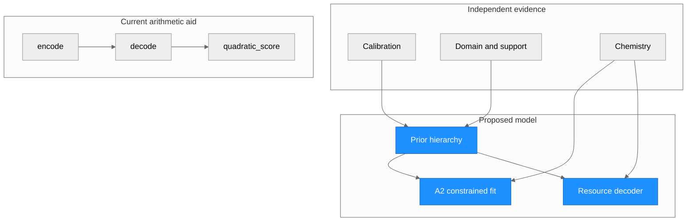

# Prior-guided EMC: mathematical design

**Checkpoint 27 October 2026: NOT ACCEPTED. Campaigns NOT RUN; external validity unestablished.** This is a proposed inverse model and an exact order-redundancy result, not an implementation of HSC or a claim about geological formation chronology. Allocation order is an algorithmic coordinate choice.

## Architecture and inputs

| Node | Role | Status |
| --- | --- | --- |
| Calibration, domain/support, chemistry | External inputs, never inferred from held-out mineral truth | Proposed |
| Prior hierarchy and A2 | Common physical-mass objective and noisy-assay comparator | Proposed |
| Resource decoder | Maps order and free fractions to feasible masses | Defined mathematically |
| `encode`, `decode`, `quadratic_score` | Exact tiny rational witnesses; score uses diagonal precisions only | Implemented arithmetic aid, not an estimator |

Let p assays, k phases, fixed C∈R₊^(p×k), observation a∈R₊^p, whole-sample budget b≥0, phase masses m∈R₊^k. Columns of C need not sum to one; all quantities use the original whole-sample basis. Residual is r=a−Cm. Fractions f_j∈[0,1] are phase-indexed and independently free **for each sample**. π permutes phases. Start r=a,t=b. For each j in π, set
u_j=min{t, min_(i:C_ij>0) r_i/C_ij}, m_j=f_j u_j, r←r−C_:j m_j, t←t−m_j.
An empty inner minimum is +∞ mathematically; the current tiny aid rejects all-zero chemistry columns. At u_j=0, set any f_j, with zero output. No clipping, rounding, forced greedy step, shared fractions, prefix rule or order-dependent C is included.

## Exact reachability theorem

For every π, image(D_π)=P={m≥0: Cm≤a, 1ᵀm≤b}. Forward: each step consumes at most every residual resource and remaining budget, preserving r,t≥0. Reverse: fix m*∈P and suppose previous phases S received their target masses. Because C,m*≥0,
r_i=a_i−Σ_(l∈S)C_il m*_l ≥Σ_(l∉S)C_il m*_l≥C_ij m*_j
and t=b−Σ_(l∈S)m*_l≥Σ_(l∉S)m*_l≥m*_j.
Thus u_j≥m*_j. Choose f_j=m*_j/u_j if u_j>0, otherwise zero (then m*_j=0). Induction reconstructs m*. The map need not be one-to-one. No rank assumption is required.

Any **final** common restriction G(m), including equality closure, lower mass bounds or fixed support, yields P∩G for every order. A prefix filter may remove paths to valid final masses. A fraction prior or penalty defined in chromosome coordinates can induce order-dependent physical-mass preferences; fair fitness must be defined on m (or use a properly transformed common density). A common fraction vector across samples can also make order affect joint reachability; that extra restriction needs geological/statistical justification. Signed C, changing C during allocation, compulsory f=1, fraction quantization and path-dependent reactions fall outside the theorem.

The hypothetical chromosome is (π,f_1,…,f_k), plus binary support z only if independent evidence warrants occurrence decisions. Its decoder is above, with f_j=0 outside support. Fitness would be one common negative physical-mass objective J(D_π(f)) with identical evidence and penalties across orders. Under the present assumptions π is redundant, so **B3 GA is not justified**. If a future discrete physical rule survives review, optimize continuous masses conditionally for each discrete choice and compare exhaustive support/rule enumeration, mixed-integer and multistart baselines before considering a hybrid GA. A GA proposal distribution can change finite search behavior without adding information.

## Noisy-assay A2 comparator

Proposed A2 minimizes J(m)=½(a−Cm)ᵀW(a−Cm)+λ/2(m−μ)ᵀK(m−μ), with W positive definite on observed channels, K positive semidefinite, λ≥0, and Q={m≥0,1ᵀm≤b} plus the same predeclared final geological constraints as B. Use 1ᵀm=b only when complete mineral inventory is independently justified. Hessian CᵀWC+λK is PSD, so affine-constrained A2 is a convex QP. Strict positivity on every nonzero feasible difference direction suffices for uniqueness. K may be a chosen regularizer; under exact closure a proper covariance inverse must act in the sum-zero tangent space. A unique regularized answer is not chemical identification.

Ordinary noisy Q does **not** impose Cm≤a. With ≤ closure and otherwise matching constraints, P⊆Q, often strictly. With equality closure, compare P∩{1ᵀm=b} against Q∩{1ᵀm=b}; unrestricted P and equality Q have no general inclusion. A matched auxiliary A2-on-P comparator isolates search from resource feasibility. If identical final-state J is globally optimized on identical feasible sets, all orders and A2-on-P have the same optimum. A2-on-Q has objective no larger when P⊆Q. Equal objective optimum does **not** imply equal held-out mineral error. Logistic-normal densities, uncertain C or support mixtures can be nonconvex, but order-independent image still gives equal global infima for one common final-state objective.

Exact witnesses: C=((1,0,0),(0,1,1)), a=(3/5,2/5), b=1 reaches m=(3/5,1/10,3/10) in every order with suitable fractions; greedy f=1 can favor either Ti phase. For C=(1,1)ᵀ,a=(1/5,4/5), b=1, P=[0,1/5], while unregularized equal-weight A2 on Q chooses 1/2 (loss 9/100 versus 9/50 at decoder cap). For a=(-1/10,3/10), P is unsupported/empty but noisy A2 chooses 1/10. Negative assays are retained signed in its likelihood and never clipped. Leftover mass b−1ᵀm is unassigned mass, not an invisible mineral. Normalizing decoded m changes Cm and is outside the design.

The present code checks exact arithmetic for at most four phases. `quadratic_score` evaluates a diagonal precision specialization with signed inputs; it neither estimates covariance nor solves A2. Independent tester results: 171 exact checks and five builder tests passed. No prior accuracy, GA benefit or coverage was measured.
